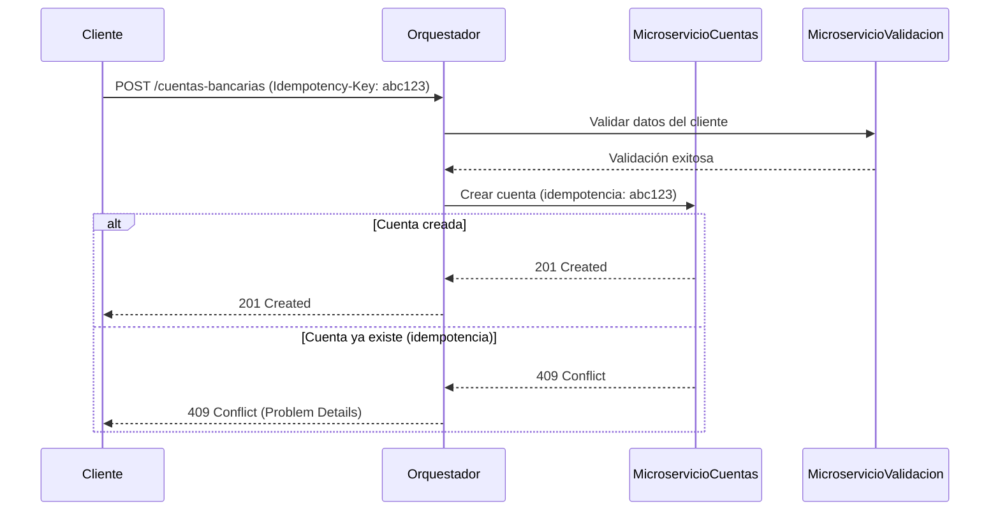

# Prompt para Mejorar el Codigo Base

Copia y pega el contenido del bloque de abajo en un asistente de IA (Claude, ChatGPT)
para obtener un ZIP con el proyecto completo y arrancable.

Si preferis trabajar en tu editor con un agente local (Claude Code, Cursor, Copilot), usa `AGENTS.md` en vez de este archivo: dice lo mismo pero para que escriba los archivos en disco.

## Las dos reglas que no se negocian

1. **Completa el boilerplate.** Todo lo que el proyecto necesita para compilar y arrancar: manifiesto de dependencias, punto de entrada, configuracion, capa de interfaz, y las capas del patron arquitectonico declarado. Eso es andamiaje y es tu trabajo.
2. **NO resuelvas el reto.** Los entregables de las fases son el trabajo de la persona. El hueco pedagogico se deja como esta: el proyecto arranca, pero lo que el reto pide implementar NO esta implementado.

Dicho de otra forma: si algo impide compilar, arreglalo. Si algo es logica de negocio incompleta, validaciones ausentes, un secreto hardcodeado o un patron mejorable, dejalo exactamente como esta — es lo que la persona tiene que encontrar.

## Superficie de practica — NO resuelvas

Estos archivos SON el ejercicio de la persona. No los implementes; deja stubs.

- `api/openapi.yaml` — El topic pide el contrato de API: openapi.yaml es el ejercicio.

## Como saber que terminaste

```bash
npx --yes @redocly/cli lint api/openapi.yaml
```

Ese comando corriendo sin errores es la definicion de "listo".

---

```
## Briefing del reto (autoridad)
Este bloque manda sobre los archivos adjuntos. El stack y el rol salen de AQUÍ, no de un topic genérico ni de markdown placeholder.

### Perfil
Chapter Integración, Especialidad Analista SOA, Tecnología Servicios Web/Microservicios, Junior

### Brecha de conocimiento
Creación y mantenimiento de APIs y microservicios. Dominar la documentación de APIs y su importancia crítica. Comprender e implementar patrones de bajo acoplamiento. Entender el ciclo de vida completo de las APIs

### Misión / candidato
Candidata junior con perfil SOA, enfocada en arquitectura e integración de servicios

### Reto
- Tema: Implementación SOA - API - MicroServicios
- Seniority: junior-l2
- Tipo: practical
- Título: Desarrollo de API y Microservicios en SOA
- Tiempo estimado: 40 horas

### Fases (trabajo del HUMANO — PROHIBIDO completarlas)
No implementes estos entregables. Dejalos como hueco pedagógico. El asistente solo materializa el proyecto arrancable para que el participante pueda trabajar.
- Fase 1: Definición del Dominio y Requisitos — objetivo: Identificar y documentar los requisitos funcionales y no funcionales del servicio de gestión de cuentas bancarias. — entregable (NO resolver): Documento de requisitos funcionales y no funcionales para el servicio de gestión de cuentas bancarias.
- Fase 2: Diseño de la API — objetivo: Diseñar la estructura de la API REST siguiendo patrones de bajo acoplamiento y asegurar su correcta documentación. — entregable (NO resolver): Especificación técnica de la API REST para el servicio de gestión de cuentas bancarias.
- Fase 3: Implementación y Pruebas — objetivo: Implementar la API y realizar pruebas para asegurar que cumple con los requisitos funcionales y no funcionales. — entregable (NO resolver): API REST implementada y documentada, con pruebas unitarias y de integración.
- Fase 4: Despliegue y Monitoreo — objetivo: Desplegar la API en un entorno de producción y configurar el monitoreo para asegurar su funcionamiento correcto. — entregable (NO resolver): API desplegada en producción con monitoreo configurado y documentación del proceso de despliegue.

Eres un asistente experto en análisis, corrección y generación de archivos de cualquier tipo:
código fuente, documentación, hojas de cálculo, documentos Word, configuraciones, entre otros.
Voy a enviarte una cadena de texto que contiene uno o más archivos. Cada archivo está delimitado por un marcador con el siguiente formato:
// === ARCHIVO: ruta/del/archivo.extension ===
o también puede aparecer como:
## === ARCHIVO: ruta/del/archivo.extension ===
Lo que sigue al marcador puede ser:

El contenido real del archivo (código, texto, YAML, etc.)
Una descripción en lenguaje natural de lo que debe contener el archivo


TU TAREA
PASO 0 — ¿Esto es un proyecto o una carcasa?
Antes de extraer archivos, leé el Briefing (si está) y diagnosticá el adjunto.

Es CARCASA si ocurre CUALQUIERA de estas:
- No hay manifiesto de dependencias del stack del briefing (manifest.json de VTEX IO / package.json / pom.xml / build.gradle / requirements.txt / go.mod / *.tf / *.csproj, según corresponda)
- Hay un "binario" que en realidad es un comentario ("no puede ser mostrado como texto plano", placeholder .fig/.docx vacío)
- Los markdowns ya completan entregables de fases posteriores ("se implementó fade-in", lista de áreas ya resuelta)

Si es CARCASA:
- MATERIALIZÁ un proyecto que arranca en el stack del briefing (VTEX IO Store Framework, Angular, Terraform, pytest, Nest, etc.). Incluí manifiesto, punto de entrada y capa de interfaz reales.
- NO copies los markdowns de "solución" como si fueran el producto. Son ruido de generación.
- NO resuelvas las fases del briefing (están marcadas PROHIBIDO). Dejá el hueco pedagógico: el flujo existe, las microinteracciones/calidad/infra que el reto pide NO están hechas.
- Después seguí al PASO 5 (ZIP).

Si es un proyecto REAL (manifiesto + código que compila o arranca):
- Seguí PASO 1 en adelante. 🔴 compilación sí. 🟡 pedagógico no.

PASO 1 — Detección y extracción
Identifica todos los archivos presentes en la cadena. Para cada archivo extrae:

Su ruta completa (ej: src/main/java/com/pragma/Service.java)
Su contenido o descripción

PASO 2 — Clasificación por tipo
Clasifica cada archivo en una de estas categorías:
A) Código fuente (Java, Python, TypeScript, JavaScript, Kotlin, etc.)
B) Configuración / documentación (YAML, properties, Markdown, JSON, txt, etc.)
C) Excel (.xlsx, .xls, .csv)
D) Word (.docx, .doc)
E) Otro tipo de archivo binario o especial
PASO 3 — Clasificación de errores en código fuente

Objetivo prioritario: que el proyecto compile. No corrijas flujo de negocio ni lógica funcional.

Antes de modificar cualquier archivo de código fuente, clasifica cada problema encontrado en una de estas dos categorías:
🔴 ERROR DE COMPILACIÓN — corregir siempre
Son errores que impiden que el proyecto arranque, sin valor pedagógico:

Import faltante o incorrecto
Clase, método o variable referenciada que no existe en ningún archivo del proyecto
Error de sintaxis
Anotación con atributos inválidos
Dependencia ausente en pom.xml, package.json, etc.
Archivo referenciado que no existe y debe ser creado con implementación mínima

→ CORREGIR estos errores.
🟡 PROBLEMA FUNCIONAL O DE CALIDAD — preservar siempre
Son problemas que no impiden compilar. Pueden ser intencionales para el aprendizaje:

Clave secreta hardcodeada ("secret", "password123")
API deprecada que funciona pero tiene reemplazo moderno
Lógica de negocio incorrecta o incompleta
Código redundante o de baja legibilidad
Falta de validaciones en flujo de negocio
Patrones de diseño incorrectos pero funcionales
Concurrencia no segura
Configuración funcional pero no óptima

→ PRESERVAR tal cual. No corregir, no mejorar, no comentar.
PASO 4 — Procesamiento según tipo de archivo
Tipo A — Código fuente
Aplica únicamente las correcciones clasificadas como 🔴 ERROR DE COMPILACIÓN.
No alteres ningún elemento clasificado como 🟡 PROBLEMA FUNCIONAL O DE CALIDAD.
Si falta un archivo referenciado, créalo con la implementación mínima necesaria para compilar.
Tipo B — Configuración / documentación
Extrae el contenido tal cual, sin modificaciones salvo errores evidentes de sintaxis
(ej: YAML mal indentado).
Tipo C — Excel (.xlsx)
Si viene con contenido real, genera el archivo respetando ese contenido.
Si viene con descripción en lenguaje natural, genera un archivo Excel funcional con:

Fila de encabezados en negrita con color de fondo distintivo
Columnas con ancho ajustado al contenido
Tipos de dato correctos por columna
Validaciones si la descripción lo indica
Hojas nombradas descriptivamente si hay más de una
Filas de ejemplo si no hay datos reales

Tipo D — Word (.docx)
Si viene con contenido real, genera el archivo respetando ese contenido.
Si viene con descripción en lenguaje natural, genera un documento Word funcional con:

Estilos de título (Título 1, Título 2) para jerarquía de secciones
Fuente legible (Calibri o equivalente), tamaño 11-12pt para cuerpo
Márgenes estándar
Tabla de contenido si tiene múltiples secciones
Tablas con encabezados en negrita si aplica

Tipo E — Otro
Genera el archivo con el contenido o estructura más apropiada según la descripción.
PASO 5 — Exportación en ZIP
Empaqueta todos los archivos en un único archivo ZIP descargable respetando exactamente
la estructura de rutas indicada por los marcadores.
El ZIP debe incluir:

Archivos de código con únicamente los errores de compilación corregidos
Archivos de configuración y documentación sin cambios
Archivos nuevos creados para resolver dependencias de compilación faltantes
Archivos Excel y Word generados desde descripción

IMPORTANTE: El ZIP debe estar listo para descargar al finalizar. No preguntes si el usuario
quiere generarlo. Simplemente genera el archivo y proporciona el enlace de descarga; No debes desplegar en el chat el resumen de lo que arreglaste al Zip, solo entregalo.

REGLAS IMPORTANTES

No omitas ningún archivo aunque no tenga errores ni modificaciones
Respeta los nombres y rutas exactas indicadas por los marcadores
Si un archivo no tiene marcador claro, infiere el nombre desde su contenido
Si la cadena contiene solo documentación, placeholders o binarios fake, NO la reproduzcas:
aplicá PASO 0 (materializar el proyecto del briefing). Reproducir la carcasa es un fallo.
No agregues texto después del enlace de descarga del ZIP
No preguntes si el usuario quiere el ZIP: simplemente generalo siempre
Si detectas que falta un archivo de configuración necesario para compilar
(pom.xml, package.json, requirements.txt, build.gradle, etc.), créalo e inclúyelo
inferiendo su contenido desde los imports y frameworks detectados en el código
Nunca corrijas problemas 🟡 aunque parezcan obvios o fáciles de mejorar.
El participante que recibirá este proyecto los debe encontrar y resolver él mismo.


INPUT
Aquí está la cadena con los archivos:

// === ARCHIVO: domain/requisitos-funcionales.md ===
# Requisitos Funcionales y No Funcionales

## 1. Actores

| Actor                | Descripción                                                                                     | Responsabilidades                                                                                     |
|----------------------|-------------------------------------------------------------------------------------------------|-------------------------------------------------------------------------------------------------------|
| **Cliente Bancario** | Usuario final que interactúa con el sistema para gestionar sus cuentas bancarias.              | - Crear cuentas bancarias.
- Consultar información de cuentas.
- Actualizar datos de cuentas.
- Eliminar cuentas.
- Realizar transferencias entre cuentas.
- Consultar movimientos y saldos. |
| **Sistema Bancario** | Sistema interno que gestiona la información de las cuentas y ejecuta operaciones financieras. | - Validar operaciones financieras.
- Aplicar políticas de negocio (ej. saldo mínimo).
- Registrar transacciones.
- Generar reportes de operaciones. |
| **Servicio de Autenticación** | Servicio externo encargado de validar la identidad de los usuarios.                          | - Autenticar usuarios mediante credenciales.
- Generar tokens de sesión.
- Validar permisos de acceso. |
| **Servicio de Notificaciones** | Servicio externo encargado de enviar notificaciones a los usuarios.                           | - Enviar notificaciones por correo electrónico.
- Enviar notificaciones por SMS.
- Registrar eventos de notificación. |

---

## 2. Operaciones CRUD

### 2.1. Creación de Cuentas (`POST /cuentas-bancarias`)

**Descripción**: Permite a un cliente bancario crear una nueva cuenta.

**Requisitos Funcionales**:
- El cliente debe proporcionar los siguientes datos obligatorios:
  - `tipoCuenta` (ej. "AHORROS", "CORRIENTE", "INVERSION").
  - `moneda` (ej. "COP", "USD", "EUR").
  - `titular` (objeto con `identificacion`, `nombre`, `apellido` y `tipoIdentificacion`).
  - `saldoInicial` (valor numérico mayor o igual a 0).
- El sistema debe validar:
  - Que el `saldoInicial` cumpla con el saldo mínimo requerido para el tipo de cuenta.
  - Que el `titular` no tenga una cuenta activa del mismo tipo y moneda.
  - Que el `tipoIdentificacion` sea válido (ej. "CC", "CE", "NIT", "PASAPORTE").
- El sistema debe generar:
  - Un `numeroCuenta` único (formato: 12 dígitos numéricos).
  - Una `fechaApertura` (timestamp en formato ISO 8601).
  - Un `estado` inicial (ej. "ACTIVA", "PENDIENTE", "BLOQUEADA").

**Requisitos No Funcionales**:
- **Idempotencia**: La operación debe ser idempotente. Si se recibe una solicitud con la misma `Idempotency-Key`, el sistema debe retornar la respuesta original sin crear una nueva cuenta.
- **Latencia**: Máximo 200ms para el 95% de las solicitudes.
- **Disponibilidad**: 99.95% mensual.
- **Seguridad**: Los datos del titular deben ser cifrados en tránsito (TLS 1.2+) y en reposo.

**Ejemplo de Solicitud**:
```json
{
  "tipoCuenta": "AHORROS",
  "moneda": "COP",
  "titular": {
    "identificacion": "123456789",
    "nombre": "Juan",
    "apellido": "Pérez",
    "tipoIdentificacion": "CC"
  },
  "saldoInicial": 100000
}
```

**Ejemplo de Respuesta Exitosa (201 Created)**:
```json
{
  "numeroCuenta": "123456789012",
  "tipoCuenta": "AHORROS",
  "moneda": "COP",
  "titular": {
    "identificacion": "123456789",
    "nombre": "Juan",
    "apellido": "Pérez",
    "tipoIdentificacion": "CC"
  },
  "saldo": 100000,
  "fechaApertura": "2023-10-01T12:00:00Z",
  "estado": "ACTIVA"
}
```

**Códigos de Error**:
- `400 Bad Request`: Datos inválidos (ej. `saldoInicial` negativo, `tipoCuenta` inexistente).
- `409 Conflict`: Cuenta duplicada para el mismo titular, tipo y moneda.
- `422 Unprocessable Entity`: Violación de reglas de negocio (ej. `saldoInicial` menor al mínimo requerido).

---

### 2.2. Consulta de Cuentas (`GET /cuentas-bancarias/{numeroCuenta}`)

**Descripción**: Permite consultar la información de una cuenta bancaria específica.

**Requisitos Funcionales**:
- El cliente debe proporcionar el `numeroCuenta` como parámetro de ruta.
- El sistema debe retornar:
  - Los datos básicos de la cuenta (`numeroCuenta`, `tipoCuenta`, `moneda`, `estado`).
  - Información del titular (`identificacion`, `nombre`, `apellido`).
  - `saldoDisponible` (valor numérico).
  - `fechaUltimaTransaccion` (timestamp en formato ISO 8601, opcional).
- El sistema debe validar:
  - Que el `numeroCuenta` exista.
  - Que el cliente tenga permisos para consultar la cuenta.

**Requisitos No Funcionales**:
- **Latencia**: Máximo 150ms para el 95% de las solicitudes.
- **Cache**: Las respuestas deben ser cacheables por 5 minutos para reducir carga en el sistema.

**Ejemplo de Respuesta Exitosa (200 OK)**:
```json
{
  "numeroCuenta": "123456789012",
  "tipoCuenta": "AHORROS",
  "moneda": "COP",
  "estado": "ACTIVA",
  "titular": {
    "identificacion": "123456789",
    "nombre": "Juan",
    "apellido": "Pérez"
  },
  "saldoDisponible": 100000,
  "fechaUltimaTransaccion": "2023-10-01T12:00:00Z"
}
```

**Códigos de Error**:
- `404 Not Found`: Cuenta no encontrada.
- `403 Forbidden`: Permisos insuficientes para consultar la cuenta.

---

### 2.3. Actualización de Cuentas (`PATCH /cuentas-bancarias/{numeroCuenta}`)

**Descripción**: Permite actualizar información de una cuenta bancaria.

**Requisitos Funcionales**:
- El cliente debe proporcionar el `numeroCuenta` como parámetro de ruta.
- El cliente puede actualizar uno o más de los siguientes campos:
  - `estado` (ej. "ACTIVA", "BLOQUEADA", "CERRADA").
  - `titular` (solo `nombre` y `apellido`).
  - `limiteSobregiro` (para cuentas corrientes, valor numérico mayor o igual a 0).
- El sistema debe validar:
  - Que el `numeroCuenta` exista.
  - Que el cliente tenga permisos para actualizar la cuenta.
  - Que los nuevos valores cumplan con las reglas de negocio (ej. `limiteSobregiro` no puede ser negativo).

**Requisitos No Funcionales**:
- **Idempotencia**: La operación debe ser idempotente. Si se recibe una solicitud con la misma `Idempotency-Key`, el sistema debe retornar la respuesta original sin realizar cambios.
- **Latencia**: Máximo 200ms para el 95% de las solicitudes.

**Ejemplo de Solicitud**:
```json
{
  "estado": "BLOQUEADA"
}
```

**Ejemplo de Respuesta Exitosa (200 OK)**:
```json
{
  "numeroCuenta": "123456789012",
  "tipoCuenta": "AHORROS",
  "moneda": "COP",
  "estado": "BLOQUEADA",
  "titular": {
    "identificacion": "123456789",
    "nombre": "Juan",
    "apellido": "Pérez"
  },
  "saldoDisponible": 100000
}
```

**Códigos de Error**:
- `400 Bad Request`: Datos inválidos (ej. `estado` inexistente).
- `404 Not Found`: Cuenta no encontrada.
- `403 Forbidden`: Permisos insuficientes para actualizar la cuenta.
- `422 Unprocessable Entity`: Violación de reglas de negocio (ej. intentar cerrar una cuenta con saldo positivo).

---

### 2.4. Eliminación de Cuentas (`DELETE /cuentas-bancarias/{numeroCuenta}`)

**Descripción**: Permite eliminar una cuenta bancaria.

**Requisitos Funcionales**:
- El cliente debe proporcionar el `numeroCuenta` como parámetro de ruta.
- El sistema debe validar:
  - Que el `numeroCuenta` exista.
  - Que el cliente tenga permisos para eliminar la cuenta.
  - Que la cuenta no tenga saldo positivo.
  - Que la cuenta no tenga transacciones pendientes.
- El sistema debe marcar la cuenta como "ELIMINADA" y no permitir operaciones posteriores.

**Requisitos No Funcionales**:
- **Idempotencia**: La operación debe ser idempotente. Si se recibe una solicitud con la misma `Idempotency-Key`, el sistema debe retornar la respuesta original.
- **Latencia**: Máximo 200ms para el 95% de las solicitudes.

**Ejemplo de Respuesta Exitosa (204 No Content)**:
```
(No hay cuerpo en la respuesta)
```

**Códigos de Error**:
- `400 Bad Request`: La cuenta no puede ser eliminada (ej. saldo positivo).
- `404 Not Found`: Cuenta no encontrada.
- `403 Forbidden`: Permisos insuficientes para eliminar la cuenta.

---

### 2.5. Consulta de Movimientos (`GET /cuentas-bancarias/{numeroCuenta}/movimientos`)

**Descripción**: Permite consultar los movimientos de una cuenta bancaria.

**Requisitos Funcionales**:
- El cliente debe proporcionar el `numeroCuenta` como parámetro de ruta.
- El cliente puede filtrar los movimientos por:
  - `fechaInicio` (timestamp en formato ISO 8601).
  - `fechaFin` (timestamp en formato ISO 8601).
  - `tipoMovimiento` (ej. "DEPOSITO", "RETIRO", "TRANSFERENCIA").
- El sistema debe retornar:
  - Una lista paginada de movimientos con los siguientes campos:
    - `idMovimiento` (UUID).
    - `tipoMovimiento`.
    - `monto` (valor numérico).
    - `fecha` (timestamp en formato ISO 8601).
    - `descripcion` (texto).
    - `saldoDespues` (valor numérico).
  - Información de paginación (`totalItems`, `totalPages`, `currentPage`).

**Requisitos No Funcionales**:
- **Latencia**: Máximo 300ms para el 95% de las solicitudes.
- **Cache**: Las respuestas deben ser cacheables por 2 minutos para reducir carga en el sistema.

**Ejemplo de Respuesta Exitosa (200 OK)**:
```json
{
  "movimientos": [
    {
      "idMovimiento": "550e8400-e29b-41d4-a716-446655440000",
      "tipoMovimiento": "DEPOSITO",
      "monto": 100000,
      "fecha": "2023-10-01T12:00:00Z",
      "descripcion": "Depósito inicial",
      "saldoDespues": 100000
    }
  ],
  "paginacion": {
    "totalItems": 1,
    "totalPages": 1,
    "currentPage": 1
  }
}
```

**Códigos de Error**:
- `404 Not Found`: Cuenta no encontrada.
- `403 Forbidden`: Permisos insuficientes para consultar los movimientos.

---

## 3. Restricciones de Dominio

### 3.1. Saldo Mínimo

| Tipo de Cuenta | Saldo Mínimo Requerido |
|----------------|-------------------------|
| AHORROS        | 50,000 COP              |
| CORRIENTE      | 0 COP                   |
| INVERSION      | 1,000,000 COP           |

### 3.2. Límites de Transacciones

| Tipo de Cuenta | Límite Diario de Retiros | Límite Mensual de Transferencias |
|----------------|--------------------------|-----------------------------------|
| AHORROS        | 2,000,000 COP           | 10,000,000 COP                    |
| CORRIENTE      | 5,000,000 COP           | 50,000,000 COP                    |
| INVERSION      | 10,000,000 COP          | 100,000,000 COP                   |

### 3.3. Tipos de Identificación Válidos

| Código | Descripción          |
|-------|----------------------|
| CC    | Cédula de Ciudadanía |
| CE    | Cédula de Extranjería|
| NIT   | NIT                  |
| PASAPORTE | Pasaporte         |

### 3.4. Estados de Cuenta

| Estado      | Descripción                                                                 |
|-------------|-----------------------------------------------------------------------------|
| ACTIVA      | Cuenta operativa y disponible para transacciones.                          |
| PENDIENTE   | Cuenta en proceso de apertura o verificación.                              |
| BLOQUEADA   | Cuenta bloqueada por seguridad o incumplimiento de políticas.              |
| CERRADA     | Cuenta cerrada por solicitud del cliente o incumplimiento de condiciones.  |
| ELIMINADA   | Cuenta eliminada del sistema (no se puede reactivar).                      |

---

## 4. Propiedades Operativas

### 4.1. Latencia

| Operación               | Latencia Máxima (P95) |
|-------------------------|-----------------------|
| Creación de Cuentas     | 200ms                 |
| Consulta de Cuentas     | 150ms                 |
| Actualización de Cuentas| 200ms                 |
| Eliminación de Cuentas  | 200ms                 |
| Consulta de Movimientos | 300ms                 |

### 4.2. Idempotencia

- Todas las operaciones de **modificación** (POST, PATCH, DELETE) deben ser idempotentes.
- Se debe utilizar el header `Idempotency-Key` con un UUIDv4 para garantizar la idempotencia.
- El sistema debe almacenar las respuestas de las operaciones idempotentes durante **24 horas**.

### 4.3. Seguridad

- **Autenticación**: Utilizar OAuth 2.0 con tokens JWT para autenticar las solicitudes.
- **Autorización**: Validar permisos de acceso mediante roles (ej. `CLIENTE`, `ADMIN`).
- **Cifrado**: Todos los datos sensibles (ej. datos del titular) deben ser cifrados en tránsito (TLS 1.2+) y en reposo.
- **Auditoría**: Registrar todas las operaciones CRUD en un sistema de auditoría para trazabilidad.

### 4.4. Disponibilidad y Escalabilidad

- **Disponibilidad**: 99.95% mensual.
- **Escalabilidad**: El sistema debe soportar **1,000 solicitudes por segundo** con la latencia especificada.
- **Alta Disponibilidad**: Implementar balanceo de carga y replicación de datos para garantizar redundancia.

### 4.5. Observabilidad

- **Logs**: Registrar todas las solicitudes y respuestas con un nivel de detalle adecuado (ej. INFO para operaciones exitosas, ERROR para fallos).
- **Métricas**: Exponer métricas de latencia, throughput y errores mediante Prometheus.
- **Trazabilidad**: Utilizar headers como `X-Request-ID` para correlacionar solicitudes entre servicios.

---

## 5. Integración con Sistemas Externos

### 5.1. Servicio de Autenticación

- **Endpoint**: `POST /auth/token`
- **Responsabilidades**:
  - Validar credenciales del usuario.
  - Generar tokens JWT con los claims necesarios (ej. `sub`, `roles`, `exp`).
- **Requisitos No Funcionales**:
  - Latencia máxima: 100ms.
  - Disponibilidad: 99.99%.

### 5.2. Servicio de Notificaciones

- **Endpoint**: `POST /notificaciones/enviar`
- **Responsabilidades**:
  - Enviar notificaciones por correo electrónico o SMS.
  - Registrar eventos de notificación para auditoría.
- **Requisitos No Funcionales**:
  - Latencia máxima: 500ms.
  - Disponibilidad: 99.9%.

---

## 6. Ejemplos de Errores del Dominio

### 6.1. Saldo Insuficiente

**Ejemplo**:
```json
{
  "type": "https://api.banco.com/errors/saldo-insuficiente",
  "title": "Saldo insuficiente",
  "status": 422,
  "detail": "El saldo disponible (50000 COP) es menor al saldo mínimo requerido (100000 COP) para el tipo de cuenta AHORROS.",
  "instance": "/cuentas-bancarias",
  "cuenta": {
    "numeroCuenta": "123456789012",
    "tipoCuenta": "AHORROS",
    "moneda": "COP"
  }
}
```

### 6.2. Cuenta Duplicada

**Ejemplo**:
```json
{
  "type": "https://api.banco.com/errors/cuenta-duplicada",
  "title": "Cuenta duplicada",
  "status": 409,
  "detail": "Ya existe una cuenta activa de tipo AHORROS en moneda COP para el titular con identificación 123456789.",
  "instance": "/cuentas-bancarias",
  "cuenta": {
    "tipoCuenta": "AHORROS",
    "moneda": "COP",
    "titular": {
      "identificacion": "123456789",
      "tipoIdentificacion": "CC"
    }
  }
}
```

### 6.3. Cuenta No Encontrada

**Ejemplo**:
```json
{
  "type": "https://api.banco.com/errors/cuenta-no-encontrada",
  "title": "Cuenta no encontrada",
  "status": 404,
  "detail": "No se encontró una cuenta con el número 123456789012.",
  "instance": "/cuentas-bancarias/123456789012"
}
```

---

## 7. Decisiones de Arquitectura

### 7.1. Patrón SOA y Bajo Acoplamiento

- **Razón**: Se eligió el patrón SOA para garantizar la modularidad y reutilización de servicios.
- **Implementación**: Cada operación CRUD se expone como un endpoint REST independiente, permitiendo que otros servicios consuman solo lo necesario.
- **Beneficios**:
  - Facilita la escalabilidad y el despliegue independiente de servicios.
  - Reduce el acoplamiento entre componentes.
  - Permite la reutilización de servicios en diferentes contextos.

### 7.2. Contrato Primero (OpenAPI)

- **Razón**: El diseño del contrato primero asegura que la API sea consistente y bien documentada desde el inicio.
- **Implementación**: Se utiliza OpenAPI 3.1 para definir la especificación de la API, incluyendo schemas, paths y ejemplos.
- **Beneficios**:
  - Facilita la generación automática de código cliente y servidor.
  - Mejora la comunicación entre equipos de desarrollo y stakeholders.
  - Permite validar el contrato antes de implementar la lógica.

### 7.3. Idempotencia

- **Razón**: Garantizar que las operaciones de modificación no se repliquen accidentalmente.
- **Implementación**: Uso del header `Idempotency-Key` para identificar solicitudes repetidas.
- **Beneficios**:
  - Evita duplicación de transacciones.
  - Mejora la experiencia del usuario al manejar solicitudes repetidas.

### 7.4. Manejo de Errores

- **Razón**: Proporcionar información clara y estructurada sobre los errores.
- **Implementación**: Uso de RFC 7807 (Problem Details) para estandarizar las respuestas de error.
- **Beneficios**:
  - Facilita la depuración y el manejo de errores por parte de los clientes.
  - Proporciona información consistente y útil para los desarrolladores.

### 7.5. Estandarización Financiera

- **Razón**: Asegurar que la API cumpla con estándares del sector financiero.
- **Implementación**: Uso de BIAN e ISO 20022 para definir tipos de datos y operaciones.
- **Beneficios**:
  - Facilita la integración con otros sistemas financieros.
  - Mejora la interoperabilidad y la adopción de la API.

---

## 8. Referencias

- [OpenAPI 3.1 Specification](https://spec.openapis.org/oas/v3.1.0)
- [RFC 7807 - Problem Details for HTTP APIs](https://tools.ietf.org/html/rfc7807)
- [BIAN Service Landscape](https://www.bian.org/)
- [ISO 20022](https://www.iso20022.org/)
- [OAuth 2.0](https://oauth.net/2/)

// === ARCHIVO: domain/mapeo-datos.csv ===
"origen","destino","tipo_origen","tipo_destino","obligatoriedad","regla_transformacion","ejemplo_origen","ejemplo_destino"
"tipoCuenta","accountType","string","string","S","Mapear valor según catálogo de tipos de cuenta. Validar que el valor esté en la lista de tipos permitidos: [AHORROS, CORRIENTE, INVERSION].","AHORROS","SAVINGS"
"moneda","currency","string","string","S","Mapear valor según catálogo de monedas ISO 4217. Validar que el valor esté en la lista de monedas permitidas: [COP, USD, EUR].","COP","COP"
"titular.identificacion","accountHolder.identificationNumber","string","string","S","Copiar el valor tal cual. Validar que el formato sea numérico para tipos CC, CE y NIT. Para PASAPORTE, permitir caracteres alfanuméricos.","123456789","123456789"
"titular.nombre","accountHolder.firstName","string","string","S","Copiar el valor tal cual. Validar que no contenga caracteres especiales ni números.","Juan","Juan"
"titular.apellido","accountHolder.lastName","string","string","S","Copiar el valor tal cual. Validar que no contenga caracteres especiales ni números.","Pérez","Perez"
"titular.tipoIdentificacion","accountHolder.identificationType","string","string","S","Mapear valor según catálogo de tipos de identificación. Validar que el valor esté en la lista permitida: [CC, CE, NIT, PASAPORTE].","CC","ID_CARD"
"saldoInicial","initialBalance","number","number","S","Convertir a número decimal con 2 decimales. Validar que el valor sea >= 0 y cumpla con el saldo mínimo requerido para el tipo de cuenta.","100000","100000.00"
"numeroCuenta","accountNumber","string","string","S","Generar un número de cuenta único de 12 dígitos. Validar que no exista en el sistema.","","123456789012"
"fechaApertura","openingDate","string","string","S","Generar timestamp en formato ISO 8601 (YYYY-MM-DDTHH:MM:SSZ).","","2023-10-01T12:00:00Z"
"estado","status","string","string","S","Mapear valor según catálogo de estados de cuenta. Validar que el valor esté en la lista permitida: [ACTIVA, PENDIENTE, BLOQUEADA, CERRADA, ELIMINADA].","ACTIVA","ACTIVE"
"limiteSobregiro","overdraftLimit","number","number","N","Convertir a número decimal con 2 decimales. Validar que el valor sea >= 0. Aplicar solo para cuentas CORRIENTE.","500000","500000.00"
"saldoDisponible","availableBalance","number","number","S","Calcular como saldo actual menos transacciones pendientes. Validar que el valor sea >= 0.","95000","95000.00"
"fechaUltimaTransaccion","lastTransactionDate","string","string","N","Mapear timestamp en formato ISO 8601 (YYYY-MM-DDTHH:MM:SSZ). Si no hay transacciones, dejar vacío.","2023-10-01T12:00:00Z","2023-10-01T12:00:00Z"
"idMovimiento","transactionId","string","string","S","Generar UUID v4. Validar unicidad.","","550e8400-e29b-41d4-a716-446655440000"
"tipoMovimiento","transactionType","string","string","S","Mapear valor según catálogo de tipos de movimiento. Validar que el valor esté en la lista permitida: [DEPOSITO, RETIRO, TRANSFERENCIA].","DEPOSITO","DEPOSIT"
"monto","amount","number","number","S","Convertir a número decimal con 2 decimales. Validar que el valor sea > 0 para DEPOSITO y TRANSFERENCIA, y < 0 para RETIRO.","100000","100000.00"
"fecha","transactionDate","string","string","S","Mapear timestamp en formato ISO 8601 (YYYY-MM-DDTHH:MM:SSZ).","","2023-10-01T12:00:00Z"
"descripcion","description","string","string","N","Copiar el valor tal cual. Validar longitud máxima de 255 caracteres.","Depósito inicial","Initial deposit"
"saldoDespues","balanceAfter","number","number","S","Calcular como saldo antes de la transacción + monto. Validar que el valor sea >= 0.","100000","100000.00"
"fechaInicio","startDate","string","string","N","Mapear timestamp en formato ISO 8601 (YYYY-MM-DDTHH:MM:SSZ). Validar que sea anterior a fechaFin.","2023-10-01T00:00:00Z","2023-10-01T00:00:00Z"
"fechaFin","endDate","string","string","N","Mapear timestamp en formato ISO 8601 (YYYY-MM-DDTHH:MM:SSZ). Validar que sea posterior a fechaInicio.","2023-10-31T23:59:59Z","2023-10-31T23:59:59Z"
"


// === ARCHIVO: proceso.bpmn.md ===
# Proceso de Gestión de Cuentas Bancarias

```bpmn
<?xml version="1.0" encoding="UTF-8"?>
<bpmn:definitions xmlns:bpmn="http://www.omg.org/spec/BPMN/20100524/MODEL"
                  xmlns:bpmndi="http://www.omg.org/spec/BPMN/20100524/DI"
                  xmlns:dc="http://www.omg.org/spec/DD/20100524/DC"
                  xmlns:di="http://www.omg.org/spec/DD/20100524/DI"
                  id="Definitions_1"
                  targetNamespace="http://bpmn.io/schema/bpmn">
  <bpmn:process id="Process_GestionCuentasBancarias" isExecutable="false">
    <bpmn:startEvent id="StartEvent_1" name="Solicitud de gestión de cuenta">
      <bpmn:outgoing>Flow_1</bpmn:outgoing>
    </bpmn:startEvent>
    <bpmn:sequenceFlow id="Flow_1" sourceRef="StartEvent_1" targetRef="Gateway_1" />
    
    <bpmn:exclusiveGateway id="Gateway_1" name="Tipo de operación">
      <bpmn:incoming>Flow_1</bpmn:incoming>
      <bpmn:outgoing>Flow_2</bpmn:outgoing>
      <bpmn:outgoing>Flow_3</bpmn:outgoing>
      <bpmn:outgoing>Flow_4</bpmn:outgoing>
      <bpmn:outgoing>Flow_5</bpmn:outgoing>
    </bpmn:exclusiveGateway>
    
    <bpmn:sequenceFlow id="Flow_2" sourceRef="Gateway_1" targetRef="Task_1">
      <bpmn:conditionExpression xsi:type="bpmn:tFormalExpression">
        ${operationType == 'CREATE'}
      </bpmn:conditionExpression>
    </bpmn:sequenceFlow>
    <bpmn:sequenceFlow id="Flow_3" sourceRef="Gateway_1" targetRef="Task_2">
      <bpmn:conditionExpression xsi:type="bpmn:tFormalExpression">
        ${operationType == 'READ'}
      </bpmn:conditionExpression>
    </bpmn:sequenceFlow>
    <bpmn:sequenceFlow id="Flow_4" sourceRef="Gateway_1" targetRef="Task_3">
      <bpmn:conditionExpression xsi:type="bpmn:tFormalExpression">
        ${operationType == 'UPDATE'}
      </bpmn:conditionExpression>
    </bpmn:sequenceFlow>
    <bpmn:sequenceFlow id="Flow_5" sourceRef="Gateway_1" targetRef="Task_4">
      <bpmn:conditionExpression xsi:type="bpmn:tFormalExpression">
        ${operationType == 'DELETE'}
      </bpmn:conditionExpression>
    </bpmn:sequenceFlow>
    
    <bpmn:task id="Task_1" name="Crear cuenta bancaria">
      <bpmn:incoming>Flow_2</bpmn:incoming>
      <bpmn:outgoing>Flow_6</bpmn:outgoing>
      <bpmn:documentation>Validar datos del cliente y crear nueva cuenta bancaria</bpmn:documentation>
    </bpmn:task>
    <bpmn:task id="Task_2" name="Consultar cuenta bancaria">
      <bpmn:incoming>Flow_3</bpmn:incoming>
      <bpmn:outgoing>Flow_7</bpmn:outgoing>
      <bpmn:documentation>Recuperar información de una cuenta existente</bpmn:documentation>
    </bpmn:task>
    <bpmn:task id="Task_3" name="Actualizar cuenta bancaria">
      <bpmn:incoming>Flow_4</bpmn:incoming>
      <bpmn:outgoing>Flow_8</bpmn:outgoing>
      <bpmn:documentation>Modificar información de una cuenta existente</bpmn:documentation>
    </bpmn:task>
    <bpmn:task id="Task_4" name="Eliminar cuenta bancaria">
      <bpmn:incoming>Flow_5</bpmn:incoming>
      <bpmn:outgoing>Flow_9</bpmn:outgoing>
      <bpmn:documentation>Marcar cuenta como inactiva (soft delete)</bpmn:documentation>
    </bpmn:task>
    
    <bpmn:sequenceFlow id="Flow_6" sourceRef="Task_1" targetRef="EndEvent_1" />
    <bpmn:sequenceFlow id="Flow_7" sourceRef="Task_2" targetRef="EndEvent_1" />
    <bpmn:sequenceFlow id="Flow_8" sourceRef="Task_3" targetRef="EndEvent_1" />
    <bpmn:sequenceFlow id="Flow_9" sourceRef="Task_4" targetRef="EndEvent_1" />
    
    <bpmn:endEvent id="EndEvent_1" name="Fin del proceso">
      <bpmn:incoming>Flow_6</bpmn:incoming>
      <bpmn:incoming>Flow_7</bpmn:incoming>
      <bpmn:incoming>Flow_8</bpmn:incoming>
      <bpmn:incoming>Flow_9</bpmn:incoming>
    </bpmn:endEvent>
    
    <!-- Subproceso para validación de datos -->
    <bpmn:subProcess id="SubProcess_1" name="Validación de datos" triggeredByEvent="false">
      <bpmn:incoming>Flow_10</bpmn:incoming>
      <bpmn:outgoing>Flow_11</bpmn:outgoing>
      <bpmn:startEvent id="StartEvent_2" name="Inicio validación">
        <bpmn:outgoing>Flow_12</bpmn:outgoing>
      </bpmn:startEvent>
      <bpmn:sequenceFlow id="Flow_12" sourceRef="StartEvent_2" targetRef="Task_5" />
      
      <bpmn:task id="Task_5" name="Validar identidad del cliente">
        <bpmn:incoming>Flow_12</bpmn:incoming>
        <bpmn:outgoing>Flow_13</bpmn:outgoing>
      </bpmn:task>
      <bpmn:sequenceFlow id="Flow_13" sourceRef="Task_5" targetRef="Task_6" />
      
      <bpmn:task id="Task_6" name="Validar capacidad financiera">
        <bpmn:incoming>Flow_13</bpmn:incoming>
        <bpmn:outgoing>Flow_14</bpmn:outgoing>
      </bpmn:task>
      <bpmn:sequenceFlow id="Flow_14" sourceRef="Task_6" targetRef="EndEvent_2" />
      
      <bpmn:endEvent id="EndEvent_2" name="Fin validación">
        <bpmn:incoming>Flow_14</bpmn:incoming>
      </bpmn:endEvent>
    </bpmn:subProcess>
    
    <!-- Manejo de errores -->
    <bpmn:intermediateThrowEvent id="ErrorEvent_1" name="Error en validación">
      <bpmn:incoming>Flow_15</bpmn:incoming>
      <bpmn:errorEventDefinition errorRef="Error_1" />
    </bpmn:intermediateThrowEvent>
    
    <bpmn:error id="Error_1" name="Datos inválidos" errorCode="400" />
    
    <bpmn:sequenceFlow id="Flow_10" sourceRef="Task_1" targetRef="SubProcess_1" />
    <bpmn:sequenceFlow id="Flow_11" sourceRef="SubProcess_1" targetRef="Task_7" />
    <bpmn:sequenceFlow id="Flow_15" sourceRef="SubProcess_1" targetRef="ErrorEvent_1" />
    
    <bpmn:task id="Task_7" name="Registrar auditoría">
      <bpmn:incoming>Flow_11</bpmn:incoming>
      <bpmn:outgoing>Flow_6</bpmn:outgoing>
      <bpmn:documentation>Registrar todas las operaciones en el sistema de auditoría</bpmn:documentation>
    </bpmn:task>
  </bpmn:process>
  
  <bpmndi:BPMNDiagram id="BPMNDiagram_1">
    <bpmndi:BPMNPlane id="BPMNPlane_1" bpmnElement="Process_GestionCuentasBancarias">
      <bpmndi:BPMNShape id="_BPMNShape_StartEvent_2" bpmnElement="StartEvent_1">
        <dc:Bounds x="100" y="100" width="36" height="36" />
      </bpmndi:BPMNShape>
      <bpmndi:BPMNShape id="Gateway_1_di" bpmnElement="Gateway_1">
        <dc:Bounds x="200" y="80" width="50" height="50" />
      </bpmndi:BPMNShape>
      <bpmndi:BPMNShape id="Task_1_di" bpmnElement="Task_1">
        <dc:Bounds x="300" y="50" width="100" height="80" />
      </bpmndi:BPMNShape>
      <bpmndi:BPMNShape id="Task_2_di" bpmnElement="Task_2">
        <dc:Bounds x="300" y="150" width="100" height="80" />
      </bpmndi:BPMNShape>
      <bpmndi:BPMNShape id="Task_3_di" bpmnElement="Task_3">
        <dc:Bounds x="300" y="250" width="100" height="80" />
      </bpmndi:BPMNShape>
      <bpmndi:BPMNShape id="Task_4_di" bpmnElement="Task_4">
        <dc:Bounds x="300" y="350" width="100" height="80" />
      </bpmndi:BPMNShape>
      <bpmndi:BPMNShape id="EndEvent_1_di" bpmnElement="EndEvent_1">
        <dc:Bounds x="500" y="200" width="36" height="36" />
      </bpmndi:BPMNShape>
    </bpmndi:BPMNPlane>
  </bpmndi:BPMNDiagram>
</bpmn:definitions>
```

## Descripción del Proceso

Este diagrama BPMN representa el flujo de negocio para la gestión de cuentas bancarias en un entorno SOA. El proceso incluye:

1. **Inicio**: Recibe una solicitud de gestión de cuenta (creación, consulta, actualización o eliminación)
2. **Decisión**: Determina el tipo de operación a realizar mediante un gateway exclusivo
3. **Operaciones**:
   - Crear cuenta bancaria (con validación previa)
   - Consultar cuenta bancaria
   - Actualizar cuenta bancaria
   - Eliminar cuenta bancaria (soft delete)
4. **Validación**: Subproceso para validar datos del cliente (identidad y capacidad financiera)
5. **Auditoría**: Registro de todas las operaciones realizadas
6. **Fin**: Finalización del proceso con respuesta adecuada

## Actores y Sistemas Involucrados

| Actor/Sistema          | Rol                                                                 |
|------------------------|---------------------------------------------------------------------|
| Cliente                | Solicita operaciones sobre sus cuentas bancarias                    |
| Sistema de Gestión     | Orquesta el flujo y coordina las operaciones                       |
| Servicio de Validación | Valida identidad y capacidad financiera del cliente                |
| Sistema de Auditoría   | Registra todas las operaciones para cumplimiento normativo         |
| Base de Datos          | Almacena la información de las cuentas bancarias                   |

## Puntos de Decisión

1. **Tipo de Operación**: El gateway exclusivo determina qué operación realizar basado en el parámetro `operationType`
2. **Validación de Datos**: Solo aplica para operaciones de creación y actualización
3. **Manejo de Errores**: Cualquier fallo en la validación genera un evento de error con código 400

## Reglas de Negocio

1. **Idempotencia**: Todas las operaciones deben ser idempotentes mediante el uso de `Idempotency-Key`
2. **Consistencia**: Las operaciones de escritura deben garantizar consistencia eventual
3. **Seguridad**: Todos los datos sensibles deben ser enmascarados en las respuestas
4. **Auditoría**: Todas las operaciones deben ser registradas con timestamp y usuario
5. **Soft Delete**: La eliminación de cuentas es lógica (marcar como inactiva)

## Métricas de Rendimiento

| Métrica                     | Valor Esperado               |
|----------------------------|-----------------------------|
| Latencia máxima            | < 200ms                     |
| Throughput                 | 1,000 solicitudes/segundo   |
| Disponibilidad             | 99.95%                      |
| Tiempo de recuperación (RTO)| < 15 minutos                |

## Referencias a Estándares

- **BIAN Service Landscape**: Se alinea con el dominio "Current Account" (BIAN Service Domain: CurrentAccount)
- **ISO 20022**: Los mensajes siguen el formato de "Account Management" (camt.080, camt.081)
- **RFC 7807**: Para estructura de mensajes de error
- **FAPI**: Para mecanismos de autenticación y autorización

## Ejemplo de Flujo Completo

1. Cliente envía solicitud POST a `/cuentas-bancarias` con payload:
   ```json
   {
     "tipo_cuenta": "AHORROS",
     "moneda": "COP",
     "titular": {
       "tipo_identificacion": "CC",
       "numero_identificacion": "123456789",
       "nombre": "Juan Pérez"
     }
   }
   ```
2. Sistema valida identidad y capacidad financiera
3. Sistema crea la cuenta y registra auditoría
4. Sistema responde con:
   ```json
   {
     "id_cuenta": "a1b2c3d4-5678-90ef-ghij-klmnopqrstuv",
     "numero_cuenta": "530000123456",
     "estado": "ACTIVA",
     "fecha_creacion": "2023-11-15T10:30:00Z"
   }
   ```

// === ARCHIVO: mapeo-de-datos.csv ===
origen,destino,tipo,obligatoriedad,regla_transformacion,ejemplo
"tipoCuenta","accountType","string","S","Mapeo directo según catálogo: AHORROS->SAVINGS, CORRIENTE->CHECKING, CDT->CD","AHORROS"
"moneda","currency","string","S","Mapeo directo según ISO 4217","COP"
"titular.tipoIdentificacion","holder.identificationType","string","S","Mapeo directo: CC->NATIONAL_ID, CE->FOREIGN_ID, NIT->TAX_ID, PASAPORTE->PASSPORT","CC"
"titular.numeroIdentificacion","holder.identificationNumber","string","S","Validar formato según tipo de identificación","123456789"
"titular.nombre","holder.name","string","S","Normalizar nombre (mayúsculas, sin caracteres especiales)","Juan Pérez"
"titular.direccion","holder.address","object","N","Transformar a objeto estructurado con campos: calle, ciudad, pais, codigoPostal","{}"
"titular.email","holder.email","string","N","Validar formato de email","juan.perez@example.com"
"titular.telefono","holder.phone","string","N","Normalizar formato internacional","+573123456789"
"saldoInicial","initialBalance","number","S","Convertir a BigDecimal con 2 decimales","10000.50"
"limiteSobregiro","overdraftLimit","number","N","Solo aplica para cuentas CORRIENTE. Convertir a BigDecimal con 2 decimales","500000"
"tasaInteres","interestRate","number","N","Convertir a porcentaje (ej: 5.2 -> 0.052)","3.5"
"fechaApertura","openingDate","string","S","Convertir a formato ISO 8601 (YYYY-MM-DDThh:mm:ssZ)","2023-11-15T00:00:00Z"
"estado","status","string","S","Mapeo directo: ACTIVA->ACTIVE, INACTIVA->INACTIVE, BLOQUEADA->BLOCKED","ACTIVA"
"sucursal","branchCode","string","S","Validar existencia en catálogo de sucursales","001"
"segmentoCliente","customerSegment","string","S","Mapeo según catálogo interno: PERSONAL->STANDARD, PYME->BUSINESS, CORPORATIVO->CORPORATE","PERSONAL"
"producto","productCode","string","S","Validar existencia en catálogo de productos","AHORROS_PERSONAL"
"fechaUltimaTransaccion","lastTransactionDate","string","N","Convertir a formato ISO 8601 si existe","2023-11-10T14:30:00Z"
"saldoDisponible","availableBalance","number","S","Calcular como saldoInicial + limiteSobregiro (si aplica)","10000.50"
"saldoContable","ledgerBalance","number","S","Igual a saldoInicial","10000.50"
"fechaCierre","closingDate","string","N","Convertir a formato ISO 8601 si existe",""
"motivoCierre","closingReason","string","N","Mapeo según catálogo interno",""
"idCliente","customerId","string","S","Generar UUID v4 basado en número de identificación","a1b2c3d4-5678-90ef-ghij-klmnopqrstuv"
"idCuenta","accountId","string","S","Generar UUID v4","a1b2c3d4-5678-90ef-ghij-klmnopqrstuv"
"numeroCuenta","accountNumber","string","S","Generar número de cuenta según algoritmo interno (ej: 53 + código sucursal + secuencia)","530012345678"
"fechaUltimaActualizacion","lastUpdatedDate","string","S","Convertir a formato ISO 8601","2023-11-15T10:30:00Z"
"usuarioActualizacion","updatedBy","string","S","Registrar usuario que realiza la operación","admin.system"
"version","version","integer","S","Iniciar en 1 y incrementar con cada actualización","1"
"metadatos","metadata","object","N","Almacenar propiedades adicionales como JSON","{}"
"idTransaccion","transactionId","string","S","Generar UUID v4 para cada operación","a1b2c3d4-5678-90ef-ghij-klmnopqrstuv"
"tipoOperacion","operationType","string","S","Mapeo directo: CREACION->CREATE, CONSULTA->READ, ACTUALIZACION->UPDATE, ELIMINACION->DELETE","CREACION"
"fechaOperacion","operationDate","string","S","Convertir a formato ISO 8601","2023-11-15T10:30:00Z"
"ipCliente","clientIp","string","N","Registrar IP del cliente si está disponible","192.168.1.1"
"userAgent","userAgent","string","N","Registrar user agent del cliente si está disponible","Mozilla/5.0"
"codigoRespuesta","responseCode","string","S","Mapeo según códigos HTTP: 200->SUCCESS, 400->BAD_REQUEST, 401->UNAUTHORIZED, 404->NOT_FOUND, 500->INTERNAL_ERROR","200"
"mensajeRespuesta","responseMessage","string","S","Mensaje descriptivo de la respuesta","Cuenta creada exitosamente"
"error.detalles","error.details","object","N","Estructura según RFC 7807 para errores","{}"
"error.tipo","error.type","string","N","URI que identifica el tipo de error","about:blank"
"error.titulo","error.title","string","N","Título descriptivo del error","Datos inválidos"
"error.estado","error.status","integer","N","Código HTTP del error","400"
"error.instancia","error.instance","string","N","URI de la instancia que produjo el error",""
"error.codigo","error.code","string","N","Código interno del error","INVALID_DATA"
"error.detalle","error.detail","string","N","Detalle específico del error","El campo 'numeroIdentificacion' no cumple con el formato requerido"

## Reglas de Transformación Adicionales

1. **Campos Obligatorios**: Todos los campos marcados con "S" deben estar presentes en la solicitud
2. **Validación de Tipos**: Los campos deben convertirse al tipo especificado (ej: string a número)
3. **Formato de Fechas**: Todas las fechas deben seguir el formato ISO 8601
4. **Generación de IDs**: Los UUID deben generarse en formato v4
5. **Normalización**: Los nombres y direcciones deben normalizarse (trim, mayúsculas)
6. **Manejo de Nulos**: Los campos opcionales no enviados deben establecerse como null
7. **Enmascaramiento**: Los campos sensibles (ej: números de identificación) deben enmascararse en respuestas

## Ejemplo de Transformación Completa

**Entrada (Origen):**
```json
{
  "tipoCuenta": "AHORROS",
  "moneda": "COP",
  "titular": {
    "tipoIdentificacion": "CC",
    "numeroIdentificacion": "123456789",
    "nombre": "Juan Pérez"
  },
  "saldoInicial": 10000.50,
  "sucursal": "001",
  "segmentoCliente": "PERSONAL",
  "producto": "AHORROS_PERSONAL"
}
```

**Salida (Destino):**
```json
{
  "accountType": "SAVINGS",
  "currency": "COP",
  "holder": {
    "identificationType": "NATIONAL_ID",
    "identificationNumber": "*********", // Enmascarado
    "name": "JUAN PÉREZ"
  },
  "initialBalance": 10000.50,
  "branchCode": "001",
  "customerSegment": "STANDARD",
  "productCode": "AHORROS_PERSONAL",
  "accountNumber": "530012345678", // Generado
  "accountId": "a1b2c3d4-5678-90ef-ghij-klmnopqrstuv", // Generado
  "customerId": "a1b2c3d4-5678-90ef-ghij-klmnopqrstuv", // Generado
  "status": "ACTIVE",
  "openingDate": "2023-11-15T00:00:00Z",
  "lastUpdatedDate": "2023-11-15T10:30:00Z",
  "updatedBy": "admin.system",
  "version": 1,
  "availableBalance": 10000.50,
  "ledgerBalance": 10000.50
}
```

## Validaciones Específicas

| Campo                  | Validación                                                                 |
|------------------------|---------------------------------------------------------------------------|
| tipoCuenta             | Debe existir en catálogo de tipos de cuenta                              |
| moneda                 | Debe ser código ISO 4217 válido                                          |
| tipoIdentificacion     | Debe existir en catálogo de tipos de identificación                      |
| numeroIdentificacion   | Formato válido según tipo (ej: CC debe ser numérico entre 5-15 dígitos) |
| nombre                 | Solo caracteres alfabéticos, espacios y apóstrofes                       |
| saldoInicial           | Debe ser >= 0 y <= límite según tipo de cuenta                           |
| sucursal               | Debe existir en catálogo de sucursales                                   |
| segmentoCliente        | Debe existir en catálogo de segmentos                                    |
| producto               | Debe existir en catálogo de productos                                    |

## Mapeo de Códigos de Error

| Código Origen          | Código Destino         | Descripción                                      |
|-----------------------|------------------------|--------------------------------------------------|
| INVALID_TYPE          | INVALID_DATA_TYPE      | Tipo de dato incorrecto                          |
| MISSING_FIELD         | MISSING_REQUIRED_FIELD | Campo obligatorio faltante                       |
| INVALID_FORMAT        | INVALID_FORMAT         | Formato inválido                                 |
| OUT_OF_RANGE          | VALUE_OUT_OF_RANGE     | Valor fuera de rango permitido                   |
| NOT_FOUND             | RESOURCE_NOT_FOUND     | Recurso no encontrado                            |
| DUPLICATE             | DUPLICATE_RESOURCE     | Recurso duplicado                                |
| UNAUTHORIZED          | UNAUTHORIZED           | No autorizado                                    |
| FORBIDDEN             | FORBIDDEN              | Prohibido                                        |
| INTERNAL_ERROR        | INTERNAL_SERVER_ERROR  | Error interno del servidor                       |

## Consideraciones Técnicas

1. **Idempotencia**: Todas las operaciones de escritura deben soportar idempotencia mediante el header `Idempotency-Key`
2. **Consistencia**: Las operaciones deben garantizar consistencia eventual en sistemas distribuidos
3. **Seguridad**: Todos los datos sensibles deben ser enmascarados en las respuestas
4. **Auditoría**: Todas las operaciones deben registrarse con timestamp, usuario y detalles
5. **Rendimiento**: El mapeo debe realizarse en < 10ms para cumplir con el SLA de 200ms
6. **Extensibilidad**: El mapeo debe permitir agregar nuevos campos sin modificar la lógica principal
7. **Trazabilidad**: Cada transformación debe generar un identificador único para seguimiento

## Herramientas Recomendadas para Implementación

1. **Lenguajes**: Java (con MapStruct), Python (con Pandas), JavaScript (con Lodash)
2. **Frameworks**: Spring Boot (Java), FastAPI (Python), Express (Node.js)
3. **Validación**: Hibernate Validator (Java), Pydantic (Python), Joi (JavaScript)
4. **Testing**: JUnit (Java), Pytest (Python), Jest (JavaScript)
5. **Documentación**: Swagger/OpenAPI, Redoc
6. **Monitoreo**: Prometheus, Grafana, ELK Stack

## Ejemplo de Implementación en Java (MapStruct)

```java
@Mapper(componentModel = "spring")
public interface AccountMapper {
    @Mapping(target = "accountType", source = "tipoCuenta")
    @Mapping(target = "currency", source = "moneda")
    @Mapping(target = "holder.identificationType", source = "titular.tipoIdentificacion")
    @Mapping(target = "holder.identificationNumber", source = "titular.numeroIdentificacion")
    @Mapping(target = "holder.name", source = "titular.nombre", qualifiedByName = "normalizeName")
    @Mapping(target = "initialBalance", source = "saldoInicial")
    @Mapping(target = "accountNumber", expression = "java(generateAccountNumber(account.getSucursal()))")
    @Mapping(target = "accountId", expression = "java(java.util.UUID.randomUUID().toString())")
    @Mapping(target = "customerId", expression = "java(generateCustomerId(account.getTitular().getNumeroIdentificacion()))")
    AccountDto toDto(AccountRequest request);

    @Named("normalizeName")
    default String normalizeName(String name) {
        return name != null ? name.trim().toUpperCase() : null;
    }
}
```

// === ARCHIVO: api/openapi.yaml ===
openapi: 3.1.0
info:
  title: API de Gestión de Cuentas Bancarias
  description: |
    Esta API permite la gestión de cuentas bancarias en un sistema SOA, siguiendo estándares de bajo acoplamiento y buenas prácticas REST.
    Incluye operaciones CRUD para cuentas bancarias, manejo de idempotencia y errores del dominio.
  version: 1.0.0
  contact:
    name: Soporte Técnico
    email: soporte@bancoejemplo.com
servers:
  - url: https://api.bancoejemplo.com/v1
    description: Servidor de producción
  - url: https://sandbox.api.bancoejemplo.com/v1
    description: Servidor de pruebas
paths:
  /cuentas-bancarias:
    post:
      tags:
        - Cuentas Bancarias
      summary: Crear una nueva cuenta bancaria
      description: |
        Crea una nueva cuenta bancaria con los datos proporcionados.
        Requiere autenticación y autorización con scope `cuentas:crear`.
        La operación es idempotente mediante el header `Idempotency-Key`.
      operationId: crearCuentaBancaria
      security:
        - OAuth2:
            - cuentas:crear
      parameters:
        - $ref: '#/components/parameters/IdempotencyKey'
      requestBody:
        description: Datos de la cuenta bancaria a crear
        required: true
        content:
          application/json:
            schema:
              $ref: '#/components/schemas/CuentaBancariaRequest'
            examples:
              solicitudEjemplo:
                $ref: './examples/request-create-account.json'
      responses:
        '201':
          description: Cuenta bancaria creada exitosamente
          headers:
            Location:
              description: URI de la cuenta bancaria creada
              schema:
                type: string
                format: uri
            Idempotency-Key:
              description: Clave de idempotencia usada en la solicitud
              schema:
                type: string
                format: uuid
          content:
            application/json:
              schema:
                $ref: '#/components/schemas/CuentaBancariaResponse'
              examples:
                respuestaEjemplo:
                  $ref: './examples/response-create-account.json'
        '400':
          description: Solicitud inválida
          content:
            application/problem+json:
              schema:
                $ref: '#/components/schemas/ProblemDetails'
              examples:
                solicitudInvalida:
                  value:
                    type: https://api.bancoejemplo.com/errors/invalid-request
                    title: Solicitud inválida
                    status: 400
                    detail: Los datos proporcionados no cumplen con el esquema requerido.
                    instance: /cuentas-bancarias
                    invalidParams:
                      - name: numeroDocumento
                        reason: debe ser un número válido de 10 dígitos
        '401':
          description: No autorizado
          content:
            application/problem+json:
              schema:
                $ref: '#/components/schemas/ProblemDetails'
              examples:
                noAutorizado:
                  value:
                    type: https://api.bancoejemplo.com/errors/unauthorized
                    title: No autorizado
                    status: 401
                    detail: Falta autenticación o token inválido
                    instance: /cuentas-bancarias
        '403':
          description: Prohibido
          content:
            application/problem+json:
              schema:
                $ref: '#/components/schemas/ProblemDetails'
              examples:
                prohibido:
                  value:
                    type: https://api.bancoejemplo.com/errors/forbidden
                    title: Prohibido
                    status: 403
                    detail: El token no tiene el scope requerido
                    instance: /cuentas-bancarias
        '409':
          description: Conflicto
          content:
            application/problem+json:
              schema:
                $ref: '#/components/schemas/ProblemDetails'
              examples:
                cuentaDuplicada:
                  value:
                    type: https://api.bancoejemplo.com/errors/conflict
                    title: Conflicto
                    status: 409
                    detail: Ya existe una cuenta con el mismo número de documento
                    instance: /cuentas-bancarias
    get:
      tags:
        - Cuentas Bancarias
      summary: Listar cuentas bancarias
      description: |
        Retorna una lista paginada de cuentas bancarias filtradas por criterios opcionales.
        Requiere autenticación y autorización con scope `cuentas:leer`.
      operationId: listarCuentasBancarias
      security:
        - OAuth2:
            - cuentas:leer
      parameters:
        - $ref: '#/components/parameters/PageNumber'
        - $ref: '#/components/parameters/PageSize'
        - name: numeroDocumento
          in: query
          description: Número de documento del titular para filtrar
          required: false
          schema:
            type: string
            pattern: '^[0-9]{10}$'
        - name: estado
          in: query
          description: Estado de la cuenta (ACTIVA, INACTIVA, BLOQUEADA)
          required: false
          schema:
            type: string
            enum: [ACTIVA, INACTIVA, BLOQUEADA]
      responses:
        '200':
          description: Lista de cuentas bancarias
          content:
            application/json:
              schema:
                type: object
                properties:
                  data:
                    type: array
                    items:
                      $ref: '#/components/schemas/CuentaBancariaResponse'
                  pagination:
                    $ref: '#/components/schemas/Pagination'
        '400':
          description: Solicitud inválida
          content:
            application/problem+json:
              schema:
                $ref: '#/components/schemas/ProblemDetails'
        '401':
          description: No autorizado
          content:
            application/problem+json:
              schema:
                $ref: '#/components/schemas/ProblemDetails'
        '403':
          description: Prohibido
          content:
            application/problem+json:
              schema:
                $ref: '#/components/schemas/ProblemDetails'
  /cuentas-bancarias/{id}:
    get:
      tags:
        - Cuentas Bancarias
      summary: Obtener una cuenta bancaria por ID
      description: |
        Retorna los detalles de una cuenta bancaria específica por su ID.
        Requiere autenticación y autorización con scope `cuentas:leer`.
      operationId: obtenerCuentaBancaria
      security:
        - OAuth2:
            - cuentas:leer
      parameters:
        - $ref: '#/components/parameters/CuentaId'
      responses:
        '200':
          description: Detalles de la cuenta bancaria
          content:
            application/json:
              schema:
                $ref: '#/components/schemas/CuentaBancariaResponse'
        '401':
          description: No autorizado
          content:
            application/problem+json:
              schema:
                $ref: '#/components/schemas/ProblemDetails'
        '403':
          description: Prohibido
          content:
            application/problem+json:
              schema:
                $ref: '#/components/schemas/ProblemDetails'
        '404':
          description: Cuenta no encontrada
          content:
            application/problem+json:
              schema:
                $ref: '#/components/schemas/ProblemDetails'
              examples:
                cuentaNoEncontrada:
                  value:
                    type: https://api.bancoejemplo.com/errors/not-found
                    title: Cuenta no encontrada
                    status: 404
                    detail: No existe una cuenta con el ID proporcionado
                    instance: /cuentas-bancarias/123e4567-e89b-12d3-a456-426614174000
    put:
      tags:
        - Cuentas Bancarias
      summary: Actualizar una cuenta bancaria
      description: |
        Actualiza los datos de una cuenta bancaria existente.
        Requiere autenticación y autorización con scope `cuentas:actualizar`.
        La operación es idempotente mediante el header `Idempotency-Key`.
      operationId: actualizarCuentaBancaria
      security:
        - OAuth2:
            - cuentas:actualizar
      parameters:
        - $ref: '#/components/parameters/CuentaId'
        - $ref: '#/components/parameters/IdempotencyKey'
      requestBody:
        description: Datos actualizados de la cuenta bancaria
        required: true
        content:
          application/json:
            schema:
              $ref: '#/components/schemas/CuentaBancariaRequest'
      responses:
        '200':
          description: Cuenta bancaria actualizada exitosamente
          content:
            application/json:
              schema:
                $ref: '#/components/schemas/CuentaBancariaResponse'
        '400':
          description: Solicitud inválida
          content:
            application/problem+json:
              schema:
                $ref: '#/components/schemas/ProblemDetails'
        '401':
          description: No autorizado
          content:
            application/problem+json:
              schema:
                $ref: '#/components/schemas/ProblemDetails'
        '403':
          description: Prohibido
          content:
            application/problem+json:
              schema:
                $ref: '#/components/schemas/ProblemDetails'
        '404':
          description: Cuenta no encontrada
          content:
            application/problem+json:
              schema:
                $ref: '#/components/schemas/ProblemDetails'
        '409':
          description: Conflicto
          content:
            application/problem+json:
              schema:
                $ref: '#/components/schemas/ProblemDetails'
    delete:
      tags:
        - Cuentas Bancarias
      summary: Eliminar una cuenta bancaria
      description: |
        Elimina una cuenta bancaria existente.
        Requiere autenticación y autorización con scope `cuentas:eliminar`.
        La operación es idempotente.
      operationId: eliminarCuentaBancaria
      security:
        - OAuth2:
            - cuentas:eliminar
      parameters:
        - $ref: '#/components/parameters/CuentaId'
      responses:
        '204':
          description: Cuenta bancaria eliminada exitosamente
        '401':
          description: No autorizado
          content:
            application/problem+json:
              schema:
                $ref: '#/components/schemas/ProblemDetails'
        '403':
          description: Prohibido
          content:
            application/problem+json:
              schema:
                $ref: '#/components/schemas/ProblemDetails'
        '404':
          description: Cuenta no encontrada
          content:
            application/problem+json:
              schema:
                $ref: '#/components/schemas/ProblemDetails'
components:
  schemas:
    CuentaBancariaRequest:
      type: object
      description: Datos para crear o actualizar una cuenta bancaria
      required:
        - tipoDocumento
        - numeroDocumento
        - nombreTitular
        - tipoCuenta
        - moneda
      properties:
        tipoDocumento:
          type: string
          description: Tipo de documento de identidad del titular
          enum: [CC, CE, PAS, NIT]
          example: CC
        numeroDocumento:
          type: string
          description: Número de documento de identidad del titular
          pattern: '^[0-9]{6,15}$'
          example: "1234567890"
        nombreTitular:
          type: string
          description: Nombre completo del titular de la cuenta
          minLength: 3
          maxLength: 100
          example: Juan Pérez
        tipoCuenta:
          type: string
          description: Tipo de cuenta bancaria
          enum: [AHORROS, CORRIENTE, CDT]
          example: AHORROS
        moneda:
          type: string
          description: Moneda de la cuenta
          enum: [COP, USD, EUR]
          example: COP
        saldoInicial:
          type: number
          description: Saldo inicial de la cuenta (opcional para creación)
          minimum: 0
          example: 10000
        sucursal:
          type: string
          description: Código de la sucursal donde se abrió la cuenta
          minLength: 3
          maxLength: 10
          example: "001"
    CuentaBancariaResponse:
      type: object
      description: Datos de una cuenta bancaria existente
      required:
        - id
        - tipoDocumento
        - numeroDocumento
        - nombreTitular
        - tipoCuenta
        - moneda
        - saldo
        - estado
        - fechaCreacion
      properties:
        id:
          type: string
          format: uuid
          description: Identificador único de la cuenta bancaria
          example: 123e4567-e89b-12d3-a456-426614174000
        tipoDocumento:
          type: string
          description: Tipo de documento de identidad del titular
          enum: [CC, CE, PAS, NIT]
          example: CC
        numeroDocumento:
          type: string
          description: Número de documento de identidad del titular
          pattern: '^[0-9]{6,15}$'
          example: "1234567890"
        nombreTitular:
          type: string
          description: Nombre completo del titular de la cuenta
          minLength: 3
          maxLength: 100
          example: Juan Pérez
        tipoCuenta:
          type: string
          description: Tipo de cuenta bancaria
          enum: [AHORROS, CORRIENTE, CDT]
          example: AHORROS
        moneda:
          type: string
          description: Moneda de la cuenta
          enum: [COP, USD, EUR]
          example: COP
        saldo:
          type: number
          description: Saldo actual de la cuenta
          minimum: 0
          example: 15000
        estado:
          type: string
          description: Estado actual de la cuenta
          enum: [ACTIVA, INACTIVA, BLOQUEADA]
          example: ACTIVA
        fechaCreacion:
          type: string
          format: date-time
          description: Fecha y hora de creación de la cuenta
          example: 2023-10-01T12:00:00Z
        sucursal:
          type: string
          description: Código de la sucursal donde se abrió la cuenta
          minLength: 3
          maxLength: 10
          example: "001"
    ProblemDetails:
      type: object
      description: Detalles del problema según RFC 7807
      required:
        - type
        - title
        - status
        - detail
        - instance
      properties:
        type:
          type: string
          format: uri
          description: URI que identifica el tipo de problema
          example: https://api.bancoejemplo.com/errors/invalid-request
        title:
          type: string
          description: Título resumido del problema
          example: Solicitud inválida
        status:
          type: integer
          description: Código de estado HTTP
          example: 400
        detail:
          type: string
          description: Descripción detallada del problema
          example: Los datos proporcionados no cumplen con el esquema requerido.
        instance:
          type: string
          format: uri
          description: URI de la solicitud que generó el problema
          example: /cuentas-bancarias
        invalidParams:
          type: array
          description: Lista de parámetros inválidos (opcional)
          items:
            type: object
            properties:
              name:
                type: string
                description: Nombre del parámetro inválido
                example: numeroDocumento
              reason:
                type: string
                description: Razón por la que el parámetro es inválido
                example: debe ser un número válido de 10 dígitos
    Pagination:
      type: object
      description: Metadata de paginación
      required:
        - pageNumber
        - pageSize
        - totalElements
        - totalPages
      properties:
        pageNumber:
          type: integer
          description: Número de página actual
          example: 1
        pageSize:
          type: integer
          description: Tamaño de la página
          example: 20
        totalElements:
          type: integer
          description: Total de elementos en la colección
          example: 100
        totalPages:
          type: integer
          description: Total de páginas disponibles
          example: 5
  parameters:
    IdempotencyKey:
      name: Idempotency-Key
      in: header
      description: Clave de idempotencia para operaciones no idempotentes por defecto
      required: true
      schema:
        type: string
        format: uuid
        example: 123e4567-e89b-12d3-a456-426614174000
    CuentaId:
      name: id
      in: path
      description: Identificador único de la cuenta bancaria
      required: true
      schema:
        type: string
        format: uuid
        example: 123e4567-e89b-12d3-a456-426614174000
    PageNumber:
      name: page
      in: query
      description: Número de página (comienza en 1)
      required: false
      schema:
        type: integer
        minimum: 1
        default: 1
    PageSize:
      name: size
      in: query
      description: Tamaño de la página
      required: false
      schema:
        type: integer
        minimum: 1
        maximum: 100
        default: 20
  securitySchemes:
    OAuth2:
      type: oauth2
      description: Autenticación mediante OAuth2 con scopes específicos
      flows:
        clientCredentials:
          tokenUrl: https://auth.bancoejemplo.com/oauth/token
          scopes:
            cuentas:crear: Crear cuentas bancarias
            cuentas:leer: Leer cuentas bancarias
            cuentas:actualizar: Actualizar cuentas bancarias
            cuentas:eliminar: Eliminar cuentas bancarias
// === ARCHIVO: api/examples/request-create-account.json ===
{
  "tipoDocumento": "CC",
  "numeroDocumento": "1234567890",
  "nombreTitular": "Juan Pérez",
  "tipoCuenta": "AHORROS",
  "moneda": "COP",
  "saldoInicial": 10000,
  "sucursal": "001"
}
// === ARCHIVO: api/examples/response-create-account.json ===
{
  "id": "123e4567-e89b-12d3-a456-426614174000",
  "tipoDocumento": "CC",
  "numeroDocumento": "1234567890",
  "nombreTitular": "Juan Pérez",
  "tipoCuenta": "AHORROS",
  "moneda": "COP",
  "saldo": 10000,
  "estado": "ACTIVA",
  "fechaCreacion": "2023-10-01T12:00:00Z",
  "sucursal": "001"
}

// === ARCHIVO: api/examples/error-insufficient-funds.json ===
{
  "type": "https://api.bancolombia.com/errors/insufficient-funds",
  "title": "Fondos insuficientes",
  "status": 403,
  "detail": "La cuenta no tiene fondos suficientes para realizar la transacción.",
  "instance": "/cuentas/12345/transacciones",
  "accountId": "12345",
  "currentBalance": 1000.50,
  "requiredAmount": 1500.00,
  "timestamp": "2023-11-15T14:30:45Z",
  "requestId": "a1b2c3d4-e5f6-7890-g1h2-i3j4k5l6m7n8",
  "retryable": false,
  "context": {
    "transactionType": "DEBIT",
    "transactionId": "txn-987654321",
    "channel": "MOBILE_APP",
    "deviceId": "dev-123456789"
  },
  "_links": {
    "self": {
      "href": "https://api.bancolombia.com/cuentas/12345/transacciones/txn-987654321"
    },
    "help": {
      "href": "https://bancolombia.com/errors/insufficient-funds"
    },
    "deposit": {
      "href": "https://api.bancolombia.com/cuentas/12345/depositos",
      "templated": true
    }
  }
}

// === ARCHIVO: integration/criterios-aceptacion.feature ===
# language: es
@gestion-cuentas
Feature: Gestión de cuentas bancarias
  Como cliente del banco
  Quiero gestionar mis cuentas bancarias mediante una API REST
  Para poder realizar operaciones básicas de manera segura y eficiente

  Background:
    Given el sistema de gestión de cuentas está disponible
    And existen las siguientes cuentas registradas:
      | accountId | accountType | balance | status   | customerId |
      | 12345     | AHORROS     | 1000.50 | ACTIVA   | cust-1     |
      | 67890     | CORRIENTE   | 500.25  | ACTIVA   | cust-2     |
    And el cliente "cust-1" tiene permisos para operar la cuenta "12345"

  @smoke
  Scenario: Crear una nueva cuenta bancaria exitosamente
    Given el cliente "cust-3" no tiene cuentas registradas
    When el cliente envía una solicitud POST a "/cuentas" con los siguientes datos:
      """
      {
        "customerId": "cust-3",
        "accountType": "AHORROS",
        "initialBalance": 0.00,
        "currency": "COP"
      }
      """
    And la solicitud incluye el header "Idempotency-Key" con valor "uuid-create-1"
    Then el sistema responde con el código de estado HTTP 201
    And el cuerpo de la respuesta contiene:
      """
      {
        "accountId": "@string@",
        "accountType": "AHORROS",
        "balance": 0.00,
        "status": "ACTIVA",
        "customerId": "cust-3",
        "createdAt": "@datetime@",
        "currency": "COP"
      }
      """
    And el sistema registra la operación en el log de auditoría

  @error-handling
  Scenario: Crear cuenta con datos inválidos devuelve error 400
    When el cliente envía una solicitud POST a "/cuentas" con los siguientes datos:
      """
      {
        "customerId": "",
        "accountType": "INVALID",
        "initialBalance": -100.00
      }
      """
    Then el sistema responde con el código de estado HTTP 400
    And el cuerpo de la respuesta contiene:
      """
      {
        "type": "https://api.bancolombia.com/errors/invalid-request",
        "title": "Solicitud inválida",
        "status": 400,
        "detail": "Los datos proporcionados no cumplen con el esquema requerido.",
        "errors": [
          {
            "field": "customerId",
            "message": "Debe ser un string no vacío"
          },
          {
            "field": "accountType",
            "message": "Debe ser uno de: AHORROS, CORRIENTE, CDT"
          },
          {
            "field": "initialBalance",
            "message": "Debe ser mayor o igual a 0"
          }
        ]
      }
      """

  @idempotency
  Scenario: Operación idempotente para creación de cuenta
    Given el cliente "cust-4" no tiene cuentas registradas
    When el cliente envía una solicitud POST a "/cuentas" con los mismos datos y mismo "Idempotency-Key" "uuid-create-2" dos veces
    Then la primera solicitud responde con HTTP 201
    And la segunda solicitud responde con HTTP 200
    And ambas respuestas contienen el mismo "accountId"

  Scenario: Consultar información de una cuenta existente
    Given existe la cuenta con ID "12345"
    When el cliente envía una solicitud GET a "/cuentas/12345"
    Then el sistema responde con el código de estado HTTP 200
    And el cuerpo de la respuesta contiene:
      """
      {
        "accountId": "12345",
        "accountType": "AHORROS",
        "balance": 1000.50,
        "status": "ACTIVA",
        "customerId": "cust-1",
        "createdAt": "@datetime@",
        "currency": "COP",
        "_links": {
          "self": {
            "href": "https://api.bancolombia.com/cuentas/12345"
          },
          "transactions": {
            "href": "https://api.bancolombia.com/cuentas/12345/transacciones"
          }
        }
      }
      """

  @error-handling
  Scenario: Consultar cuenta inexistente devuelve error 404
    When el cliente envía una solicitud GET a "/cuentas/99999"
    Then el sistema responde con el código de estado HTTP 404
    And el cuerpo de la respuesta contiene:
      """
      {
        "type": "https://api.bancolombia.com/errors/not-found",
        "title": "Recurso no encontrado",
        "status": 404,
        "detail": "La cuenta con ID 99999 no existe.",
        "instance": "/cuentas/99999"
      }
      """

  Scenario: Actualizar el estado de una cuenta
    Given existe la cuenta con ID "67890" y estado "ACTIVA"
    When el cliente envía una solicitud PATCH a "/cuentas/67890" con:
      """
      {
        "status": "BLOQUEADA",
        "reason": "Fraude detectado"
      }
      """
    Then el sistema responde con el código de estado HTTP 200
    And el cuerpo de la respuesta contiene:
      """
      {
        "accountId": "67890",
        "status": "BLOQUEADA",
        "reason": "Fraude detectado",
        "updatedAt": "@datetime@"
      }
      """
    And el sistema registra el cambio en el log de auditoría

  @error-handling
  Scenario: Actualizar cuenta con estado inválido devuelve error 400
    Given existe la cuenta con ID "12345"
    When el cliente envía una solicitud PATCH a "/cuentas/12345" con:
      """
      {
        "status": "INVALID_STATUS"
      }
      """
    Then el sistema responde con el código de estado HTTP 400
    And el cuerpo de la respuesta contiene:
      """
      {
        "type": "https://api.bancolombia.com/errors/invalid-request",
        "title": "Solicitud inválida",
        "status": 400,
        "detail": "El estado proporcionado no es válido.",
        "errors": [
          {
            "field": "status",
            "message": "Debe ser uno de: ACTIVA, BLOQUEADA, CERRADA"
          }
        ]
      }
      """

  @error-handling
  Scenario: Eliminar cuenta con saldo positivo devuelve error 403
    Given existe la cuenta con ID "12345" y balance 1000.50
    When el cliente envía una solicitud DELETE a "/cuentas/12345"
    Then el sistema responde con el código de estado HTTP 403
    And el cuerpo de la respuesta contiene:
      """
      {
        "type": "https://api.bancolombia.com/errors/insufficient-conditions",
        "title": "Condiciones insuficientes para la operación",
        "status": 403,
        "detail": "No se puede eliminar una cuenta con saldo positivo.",
        "accountId": "12345",
        "currentBalance": 1000.50,
        "requiredBalance": 0.00
      }
      """

  Scenario: Eliminar cuenta con saldo cero
    Given existe la cuenta con ID "67890" y balance 0.00
    When el cliente envía una solicitud DELETE a "/cuentas/67890"
    Then el sistema responde con el código de estado HTTP 204
    And el sistema marca la cuenta como "CERRADA" en la base de datos
    And el sistema registra la operación en el log de auditoría

  @performance
  Scenario: Respuesta dentro del SLA para consultas de cuentas
    Given existen 1000 cuentas en el sistema
    When el cliente envía 100 solicitudes GET concurrentes a "/cuentas/{accountId}" con diferentes IDs
    Then cada solicitud responde en menos de 200ms
    And todas las respuestas tienen código HTTP 200

  @resilience
  Scenario: Servicio tolera fallos parciales en dependencias
    Given el servicio de auditoría está caído
    When el cliente envía una solicitud POST a "/cuentas"
    Then el sistema responde con HTTP 201
    And el sistema registra el fallo de auditoría en un circuito breaker
    And el sistema encola la operación de auditoría para reprocesamiento

// === ARCHIVO: integration/analisis-riesgo.md ===
# Análisis de Riesgo para la Integración del Servicio de Gestión de Cuentas

## 1. Introducción
Este documento identifica los modos de falla potenciales en la integración del servicio de gestión de cuentas bancarias, evalúa su impacto y propone estrategias de mitigación. El análisis sigue la metodología FMEA (Failure Modes and Effects Analysis) adaptada a sistemas distribuidos.

## 2. Alcance
- **Sistema**: API REST de gestión de cuentas bancarias
- **Interfaces**: HTTP/REST, headers de idempotencia, payloads JSON
- **Protocolos**: HTTP/1.1 con TLS 1.2+, JSON Schema Draft 2020-12
- **Volumen**: 1,000 solicitudes/segundo con latencia < 200ms
- **Estándares**: RFC 7807 (Problem Details), BIAN Service Landscape, ISO 20022

## 3. Modos de Falla y Análisis

### 3.1. Fallas en la Capa de Contrato
| Modo de Falla                     | Causa Raíz                                                                 | Impacto                                                                                     | Severidad (1-10) | Probabilidad (1-10) | Riesgo | Mitigación                                                                                     |
|------------------------------------|----------------------------------------------------------------------------|---------------------------------------------------------------------------------------------|------------------|----------------------|--------|-----------------------------------------------------------------------------------------------|
| Esquema OpenAPI desactualizado    | Cambios en el dominio no reflejados en el contrato                         | Inconsistencia entre documentación y implementación, errores en clientes generados        | 7                | 5                    | 35     | Pipeline CI/CD con validación automática del contrato contra implementación (Redocly lint)    |
| Payloads con tipos incorrectos    | Mapeo de datos incorrecto entre sistemas origen/destino                    | Rechazo de transacciones válidas o procesamiento de datos inválidos                         | 8                | 4                    | 32     | Validación estricta de schemas con JSON Schema Draft 2020-12 y ejemplos en cada endpoint      |
| Headers faltantes o inválidos     | Falta de documentación o implementación incorrecta de headers              | Rechazo de solicitudes, falta de idempotencia                                               | 6                | 6                    | 36     | Middleware de validación de headers obligatorios (Idempotency-Key, Content-Type)            |

### 3.2. Fallas en la Capa de Negocio
| Modo de Falla                     | Causa Raíz                                                                 | Impacto                                                                                     | Severidad | Probabilidad | Riesgo | Mitigación                                                                                     |
|------------------------------------|----------------------------------------------------------------------------|---------------------------------------------------------------------------------------------|------------|--------------|--------|-----------------------------------------------------------------------------------------------|
| Fondos insuficientes no detectados| Lógica de validación incorrecta en transacciones de débito                 | Sobre-giro de cuentas, pérdidas financieras para el banco                                  | 9          | 3            | 27     | Validación síncrona del saldo antes de procesar transacciones + compensación con reservas    |
| Duplicación de operaciones        | Falta de idempotencia en endpoints POST/PATCH                              | Creación de cuentas duplicadas, actualizaciones inconsistentes                             | 8          | 5            | 40     | Implementación de idempotencia con cache de claves (TTL 24h) y UUIDv4 obligatorio            |
| Inconsistencia en estados de cuenta| Transacciones no atomicicas entre sistemas                                | Estados de cuenta incorrectos visibles para clientes                                       | 9          | 4            | 36     | Saga pattern con compensación para operaciones multi-sistema + eventual consistency          |
| Falta de trazabilidad             | Logs incompletos o no correlacionados                                      | Dificultad para auditar operaciones, incumplimiento de regulaciones                        | 7          | 6            | 42     | Headers de correlación (X-Request-ID) + logs estructurados con contexto completo              |

### 3.3. Fallas en la Capa de Infraestructura
| Modo de Falla                     | Causa Raíz                                                                 | Impacto                                                                                     | Severidad | Probabilidad | Riesgo | Mitigación                                                                                     |
|------------------------------------|----------------------------------------------------------------------------|---------------------------------------------------------------------------------------------|------------|--------------|--------|-----------------------------------------------------------------------------------------------|
| Latencia > 200ms                  | Sobrecarga en el servicio o dependencias lentas                            | Degradación de experiencia de usuario, posibles timeouts en clientes                       | 6          | 7            | 42     | Circuit breaker (Resilience4j) + caching con Redis (TTL 5s) para consultas frecuentes        |
| Servicio no disponible            | Fallo en el despliegue o dependencias caídas                               | Interrupción del servicio, pérdida de operaciones                                           | 10         | 2            | 20     | Alta disponibilidad con réplicas en múltiples zonas + health checks                          |
| Pérdida de datos                  | Fallo en la persistencia sin mecanismos de recuperación                    | Inconsistencia permanente en cuentas, incumplimiento de regulaciones                       | 10         | 1            | 10     | Transacciones ACID en base de datos + replica asíncrona en otra región                       |
| Ataques de denegación de servicio | Alto volumen de solicitudes maliciosas                                     | Inaccesibilidad del servicio para usuarios legítimos                                        | 8          | 5            | 40     | Rate limiting (100 req/min por cliente) + WAF con reglas OWASP                               |

## 4. Estrategias de Mitigación Transversales

### 4.1. Idempotencia
- **Mecanismo**: Header `Idempotency-Key` con UUIDv4 obligatorio para todas las operaciones no idempotentes por defecto (POST, PATCH)
- **Implementación**:
  - Cache distribuido (Redis) con TTL de 24 horas para almacenar respuestas idempotentes
  - Middleware que valida la existencia de la clave antes de procesar la solicitud
  - Respuesta HTTP 200 con el mismo payload para solicitudes duplicadas
- **Ejemplo de flujo**:
  ```mermaid
  sequenceDiagram
    participant Cliente
    participant API
    participant Redis
    Cliente->>API: POST /cuentas (Idempotency-Key: uuid-123)
    API->>Redis: Verificar existencia de uuid-123
    Redis-->>API: No existe
    API->>API: Procesar solicitud
    API->>Redis: Almacenar uuid-123 con respuesta
    API-->>Cliente: HTTP 201 (Creado)
    Cliente->>API: POST /cuentas (Idempotency-Key: uuid-123)
    API->>Redis: Verificar existencia de uuid-123
    Redis-->>API: Existe
    API-->>Cliente: HTTP 200 (Mismo payload)
  ```

### 4.2. Manejo de Errores
- **Estándar**: RFC 7807 (Problem Details) para todos los errores del dominio
- **Códigos de error predefinidos**:
  - `400`: Invalid-request (datos de entrada inválidos)
  - `403`: Insufficient-funds / Insufficient-conditions
  - `404`: Not-found (recurso no existe)
  - `409`: Conflict (estado inválido para la operación)
  - `429`: Too-many-requests
  - `500`: Internal-server-error (fallos no recuperables)
- **Ejemplo de respuesta**:
  ```json
  {
    "type": "https://api.bancolombia.com/errors/insufficient-funds",
    "title": "Fondos insuficientes",
    "status": 403,
    "detail": "La cuenta no tiene fondos suficientes para realizar la transacción.",
    "accountId": "12345",
    "currentBalance": 1000.50,
    "requiredAmount": 1500.00,
    "retryable": false,
    "_links": {
      "deposit": {
        "href": "https://api.bancolombia.com/cuentas/12345/depositos"
      }
    }
  }
  ```

### 4.3. Resiliencia
- **Patrones implementados**:
  1. **Circuit Breaker**: Para dependencias externas (ej. servicio de auditoría)
     - Umbral de fallos: 5 errores consecutivos
     - Tiempo de espera: 30 segundos
     - Estado: Cerrado → Abierto → Medio abierto
  2. **Retry con Backoff Exponencial**: Para operaciones recuperables (ej. fallos temporales en BD)
     - Intentos máximos: 3
     - Tiempo inicial: 100ms
     - Factor: 2
  3. **Fallback**: Para operaciones no críticas
     - Ejemplo: Si el servicio de notificaciones falla, encolar la notificación para procesamiento posterior

- **Herramientas**:
  - Resilience4j para circuit breaker y retry
  - Kafka para colas de fallback
  - Redis para caching de consultas frecuentes

### 4.4. Observabilidad
- **Métricas**:
  - Latencia por endpoint (p50, p90, p99)
  - Tasa de error por endpoint
  - Throughput (solicitudes/segundo)
  - Tamaño promedio de payloads
- **Logs**:
  - Estructurados en JSON con campos obligatorios:
    ```json
    {
      "timestamp": "ISO8601",
      "level": "INFO|WARN|ERROR",
      "requestId": "UUID",
      "accountId": "string",
      "operation": "string",
      "durationMs": number,
      "statusCode": number,
      "errorType": "string (opcional)"
    }
    ```
- **Trazas**:
  - Headers de correlación `X-Request-ID` propagados a todas las dependencias
  - Integración con Jaeger para tracing distribuido

## 5. Plan de Contingencia

| Escenario                          | Acción                                                                                     | Responsable          | Tiempo de Respuesta |
|------------------------------------|-------------------------------------------------------------------------------------------|----------------------|---------------------|
| Servicio caído                    | Failover a réplica en otra zona + notificación a DevOps                                  | Equipo de Operaciones| < 5 minutos         |
| Base de datos inaccesible          | Switch a réplica asíncrona + notificación a DBA                                          | Equipo de Datos      | < 10 minutos        |
| Ataque DDoS                        | Activar reglas WAF adicionales + escalar a equipo de Seguridad                           | Equipo de Seguridad  | < 15 minutos        |
| Contrato OpenAPI desactualizado    | Rollback a versión anterior del contrato + notificación a equipo de Desarrollo           | Equipo de Desarrollo | < 30 minutos        |
| Fuga de datos                      | Aislar el servicio + escalar a Legal y Seguridad                                          | Equipo de Seguridad  | < 1 hora            |

## 6. Cumplimiento de Estándares

### 6.1. BIAN Service Landscape
- **Servicio mapeado**: `Account Management` (BIAN Service Domain)
- **Operaciones alineadas**:
  - `OpenAccount` → POST `/cuentas`
  - `UpdateAccount` → PATCH `/cuentas/{accountId}`
  - `RetrieveAccount` → GET `/cuentas/{accountId}`
  - `CloseAccount` → DELETE `/cuentas/{accountId}`
- **Atributos**:
  - `accountId`: Identificador único de la cuenta
  - `accountType`: Categorización según BIAN (AHORROS, CORRIENTE, CDT)
  - `accountStatus`: Estados definidos por BIAN (ACTIVA, BLOQUEADA, CERRADA)

### 6.2. ISO 20022
- **Mensajes utilizados**:
  - `acmt.007`: Account modification notification
  - `acmt.008`: Account closure notification
- **Elementos de datos**:
  - `Acct`: Estructura de cuenta con `Id` y `Tp`
  - `Bal`: Balance de la cuenta
  - `Sts`: Estado de la cuenta

### 6.3. FAPI (Financial-grade API)
- **Requisitos cumplidos**:
  - Autenticación OAuth 2.0 con scope `accounts`
  - Headers de seguridad: `Authorization`, `x-fapi-interaction-id`
  - TLS 1.2+ obligatorio
  - Rate limiting por cliente

## 7. Escenarios de Prueba para Validación de Riesgos

### 7.1. Prueba de Idempotencia
**Objetivo**: Validar que operaciones duplicadas no generan efectos secundarios no deseados.

**Escenario**:
1. Enviar solicitud POST `/cuentas` con `Idempotency-Key: uuid-1`
2. Registrar el `accountId` generado
3. Enviar la misma solicitud con el mismo `Idempotency-Key`
4. Validar que:
   - La segunda respuesta es HTTP 200
   - El `accountId` es el mismo que en el paso 2
   - No se creó una nueva cuenta en la base de datos

**Herramientas**: Postman/SoapUI + consulta directa a BD

### 7.2. Prueba de Resiliencia
**Objetivo**: Validar que el servicio tolera fallos parciales en dependencias.

**Escenario**:
1. Detener el servicio de auditoría
2. Enviar solicitud POST `/cuentas`
3. Validar que:
   - La respuesta es HTTP 201
   - El circuito breaker del servicio de auditoría está en estado abierto
   - La operación de auditoría está encolada para reprocesamiento

**Herramientas**: Resilience4j + Kafka + logs

### 7.3. Prueba de Carga
**Objetivo**: Validar que el servicio cumple con el SLA de latencia bajo carga.

**Escenario**:
1. Generar 1,000 solicitudes GET `/cuentas/{accountId}` concurrentes
2. Medir latencia p99
3. Validar que:
   - Latencia p99 < 200ms
   - Tasa de error = 0%
   - Throughput >= 1,000 req/segundo

**Herramientas**: Gatling/JMeter + Prometheus/Grafana

## 8. Conclusiones
- Los riesgos más críticos están asociados a la **inconsistencia de datos** (severidad 9) y la **falta de idempotencia** (riesgo 40).
- Las estrategias de mitigación propuestas (idempotencia, circuit breaker, observabilidad) reducen significativamente el impacto de estos riesgos.
- El cumplimiento de estándares BIAN e ISO 20022 asegura la interoperabilidad con otros sistemas financieros.
- La implementación de FAPI garantiza un nivel adecuado de seguridad para una API financiera.

## 9. Recomendaciones
1. Implementar un **pipeline de CI/CD** que valide automáticamente:
   - La sintaxis del OpenAPI con `redocly lint`
   - La coherencia entre el contrato y la implementación
   - Los ejemplos de payloads en los endpoints

2. Realizar **pruebas de penetración** para validar la seguridad de la API, especialmente en:
   - Autenticación y autorización
   - Validación de headers
   - Rate limiting

3. Documentar un **runbook** para operaciones que incluya:
   - Pasos para failover manual
   - Comandos para verificar el estado de los circuit breakers
   - Procedimientos para reprocesar operaciones fallidas

4. Establecer **alertas proactivas** para:
   - Latencia > 150ms
   - Tasa de error > 1%
   - Circuit breakers abiertos

5. Realizar **simulacros de recuperación** trimestrales para validar la efectividad del plan de contingencia.

// === ARCHIVO: docs/README.md ===
# Documentación del Proyecto: API de Gestión de Cuentas Bancarias

## Decisión Arquitectónica: Orquestación Centralizada vs. Coreografía

Este proyecto adopta un **enfoque orquestado** para la integración del servicio de gestión de cuentas bancarias, donde un componente central (el API Gateway o un servicio de orquestación) coordina las interacciones entre los diferentes microservicios y sistemas externos. Esta decisión se fundamenta en los siguientes trade-offs:

### Ventajas del Enfoque Orquestado
1. **Control Centralizado**
   - Facilita la gestión de flujos complejos que involucran múltiples pasos (ej: apertura de cuenta con validaciones en paralelo).
   - Permite implementar políticas de seguridad, logging y monitoreo de manera consistente en un solo punto.

2. **Visibilidad del Flujo de Negocio**
   - El orquestador tiene una vista completa del proceso, lo que simplifica el seguimiento de transacciones y la identificación de cuellos de botella.
   - Ideal para cumplir con requisitos de trazabilidad regulatorios (ej: ISO 20022, PSD2).

3. **Manejo de Errores Unificado**
   - Los errores se gestionan en el orquestador, evitando que cada microservicio implemente su propia lógica de compensación.
   - Permite aplicar patrones como **Saga** para manejar transacciones distribuidas (ej: rollback de operaciones en caso de fallo).

4. **Idempotencia Garantizada**
   - El orquestador puede validar claves de idempotencia (`Idempotency-Key`) antes de invocar a los microservicios, evitando duplicados.

### Desventajas y Mitigaciones
1. **Punto Único de Falla**
   - *Mitigación*: Implementar redundancia activa-activa en el orquestador y configurar timeouts estrictos en las llamadas a microservicios.

2. **Acoplamiento Moderado**
   - *Mitigación*: Usar contratos basados en **OpenAPI 3.1** para definir las interfaces de los microservicios, permitiendo cambios internos sin afectar al orquestador.

3. **Latencia Adicional**
   - *Mitigación*: Optimizar el orquestador para manejar **1,000 solicitudes/segundo** con una latencia máxima de **200ms**, usando:
     - Caché para respuestas frecuentes (ej: consulta de saldos).
     - Circuit Breakers para evitar cascadas de fallos.
     - Colas de mensajes (ej: Kafka) para operaciones asíncronas.

### Alternativa: Coreografía
Un enfoque coreografiado (event-driven) sería más adecuado si:
- Los flujos fueran simples y lineales (ej: notificaciones).
- Se priorizara la escalabilidad horizontal sobre la visibilidad del flujo.
- Los microservicios tuvieran alta autonomía y no requirieran coordinación central.

Sin embargo, para este caso de uso (gestión de cuentas bancarias), donde la **trazabilidad**, **idempotencia** y **cumplimiento normativo** son críticos, la orquestación ofrece un balance superior.

## Estructura del Proyecto
```
.
├── api/
│   ├── openapi.yaml                # Contrato OpenAPI 3.1 (punto de entrada para generación de código)
│   ├── examples/                    # Ejemplos de requests/responses en JSON
│   │   ├── request-create-account.json
│   │   ├── response-create-account.json
│   │   └── error-insufficient-funds.json
│   └── schemas/                     # Esquemas reutilizables (ej: Problem Details, Account)
├── domain/
│   ├── requisitos-funcionales.md    # Requisitos funcionales y no funcionales
│   └── mapeo-datos.csv              # Mapeo de campos origen-destino con reglas de transformación
├── integration/
│   ├── criterios-aceptacion.feature # Escenarios Gherkin para pruebas de aceptación
│   └── analisis-riesgo.md           # Modos de fallo y estrategias de mitigación
├── proceso.bpmn.md                  # Flujo de negocio en notación BPMN
└── docs/
    └── README.md                    # Este archivo
```

## Validación del Contrato OpenAPI
Para validar la especificación OpenAPI (`api/openapi.yaml`), ejecuta el siguiente comando usando `@redocly/cli`:

```bash
npx @redocly/cli@1.12.0 lint api/openapi.yaml
```

### Requisitos Previos
1. **Node.js** (v16 o superior).
2. **npm** o **yarn** para instalar `@redocly/cli`.
3. **OpenAPI 3.1** compatible con JSON Schema Draft 2020-12.

### Salida Esperada
- **Cero errores**: El contrato debe validar sin advertencias críticas.
- **Advertencias aceptables**: Solo se permiten warnings relacionados con:
  - Descripciones faltantes en schemas (se completarán en fases posteriores).
  - Ejemplos no proporcionados (se agregarán en `api/examples/`).

## Comandos Útiles
| Comando                                      | Descripción                                                                 |
|-----------------------------------------------|-----------------------------------------------------------------------------|
| `npx @redocly/cli lint api/openapi.yaml`      | Valida el contrato OpenAPI contra reglas estándar.                          |
| `npx @openapitools/openapi-generator-cli generate -i api/openapi.yaml -g typescript-axios -o src/client` | Genera un cliente TypeScript basado en el contrato. |
| `npm install -g @stoplight/spectral-cli && spectral lint api/openapi.yaml` | Valida el contrato con reglas personalizadas (ej: BIAN). |

## Estándares Aplicados
1. **BIAN (Banking Industry Architecture Network)**
   - Se alinean los endpoints con los **Service Domains** de BIAN (ej: `Customer Relationship Management`, `Party Management`).
   - Ejemplo: El endpoint `/cuentas-bancarias` corresponde al **Service Domain** `Current Account` de BIAN.

2. **ISO 20022**
   - Los mensajes de error siguen el estándar **Problem Details (RFC 7807)**, con campos adicionales como:
     - `code`: Código de error específico del dominio (ej: `INSUFFICIENT_FUNDS`).
     - `detail`: Descripción legible para el usuario.
     - `source`: Origen del error (ej: `{ "pointer": "/saldo" }`).

3. **FAPI (Financial-grade API)**
   - Se incluyen headers de seguridad obligatorios:
     - `Authorization`: Token JWT con scope `accounts`.
     - `x-fapi-interaction-id`: UUID para trazabilidad.
     - `x-fapi-customer-ip-address`: IP del cliente para detección de fraudes.

4. **Idempotencia**
   - Las operaciones no idempotentes por defecto (ej: `POST /cuentas-bancarias`) requieren el header:
     ```http
     Idempotency-Key: <UUIDv4>
     ```
   - El orquestador valida que no existan dos requests con la misma clave en un período de **24 horas**.

## Ejemplo de Flujo de Negocio


## Trade-offs Técnicos
| Decisión               | Alternativa               | Justificación                                                                 |
|------------------------|---------------------------|-------------------------------------------------------------------------------|
| OpenAPI 3.1            | GraphQL                   | Estándar en la industria financiera para APIs REST, con mejor soporte para BIAN. |
| Orquestación           | Coreografía               | Mayor control sobre flujos complejos y trazabilidad para cumplimiento normativo. |
| JSON Schema Draft 2020 | JSON Schema 2019          | Soporte para `unevaluatedProperties: false` para mayor seguridad en esquemas.   |
| RFC 7807 (Problem)     | Errores ad-hoc            | Estándar para errores en APIs, con extensibilidad para códigos de dominio.     |

## Herramientas Recomendadas
1. **Swagger Editor**: Para visualizar y editar el contrato OpenAPI.
   - URL: [https://editor.swagger.io](https://editor.swagger.io)

2. **Postman/Insomnia**: Para probar los endpoints con ejemplos predefinidos.
   - Importar el contrato `api/openapi.yaml` y usar los ejemplos en `api/examples/`.

3. **BPMN.io**: Para editar el flujo de negocio en `proceso.bpmn.md`.
   - URL: [https://bpmn.io](https://bpmn.io)

4. **Redocly**: Para generar documentación estática del API.
   - Comando:
     ```bash
     npx @redocly/cli build-docs api/openapi.yaml -o docs/index.html
     ```

## Pasos Siguientes
1. **Fase 1**: Revisar los requisitos funcionales en `domain/requisitos-funcionales.md`.
2. **Fase 2**: Validar el contrato OpenAPI con `npx @redocly/cli lint api/openapi.yaml`.
3. **Fase 3**: Generar código cliente/servidor usando OpenAPI Generator.
4. **Fase 4**: Implementar pruebas de aceptación con los escenarios en `integration/criterios-aceptacion.feature`.

## Notas de Seguridad
- **Autenticación**: Usar OAuth 2.0 con scope `accounts` para todos los endpoints.
- **Rate Limiting**: Máximo 100 solicitudes por minuto por cliente (configurable).
- **Cifrado**: TLS 1.2+ obligatorio en todas las comunicaciones.
- **Datos Sensibles**: Nunca exponer números de cuenta completos en respuestas (usar máscaras como `****1234`).

```
