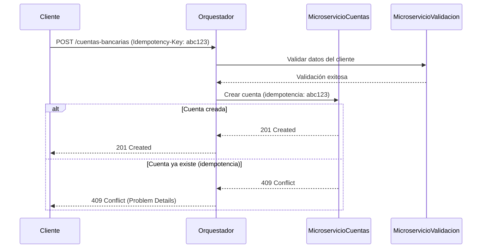

# Documentación del Proyecto: API de Gestión de Cuentas Bancarias

## Decisión Arquitectónica: Orquestación Centralizada vs. Coreografía

Este proyecto adopta un **enfoque orquestado** para la integración del servicio de gestión de cuentas bancarias, donde un componente central (el API Gateway o un servicio de orquestación) coordina las interacciones entre los diferentes microservicios y sistemas externos. Esta decisión se fundamenta en los siguientes trade-offs:

### Ventajas del Enfoque Orquestado
1. **Control Centralizado**
   - Facilita la gestión de flujos complejos que involucran múltiples pasos (ej: apertura de cuenta con validaciones en paralelo).
   - Permite implementar políticas de seguridad, logging y monitoreo de manera consistente en un solo punto.

2. **Visibilidad del Flujo de Negocio**
   - El orquestador tiene una vista completa del proceso, lo que simplifica el seguimiento de transacciones y la identificación de cuellos de botella.
   - Ideal para cumplir con requisitos de trazabilidad regulatorios (ej: ISO 20022, PSD2).

3. **Manejo de Errores Unificado**
   - Los errores se gestionan en el orquestador, evitando que cada microservicio implemente su propia lógica de compensación.
   - Permite aplicar patrones como **Saga** para manejar transacciones distribuidas (ej: rollback de operaciones en caso de fallo).

4. **Idempotencia Garantizada**
   - El orquestador puede validar claves de idempotencia (`Idempotency-Key`) antes de invocar a los microservicios, evitando duplicados.

### Desventajas y Mitigaciones
1. **Punto Único de Falla**
   - *Mitigación*: Implementar redundancia activa-activa en el orquestador y configurar timeouts estrictos en las llamadas a microservicios.

2. **Acoplamiento Moderado**
   - *Mitigación*: Usar contratos basados en **OpenAPI 3.1** para definir las interfaces de los microservicios, permitiendo cambios internos sin afectar al orquestador.

3. **Latencia Adicional**
   - *Mitigación*: Optimizar el orquestador para manejar **1,000 solicitudes/segundo** con una latencia máxima de **200ms**, usando:
     - Caché para respuestas frecuentes (ej: consulta de saldos).
     - Circuit Breakers para evitar cascadas de fallos.
     - Colas de mensajes (ej: Kafka) para operaciones asíncronas.

### Alternativa: Coreografía
Un enfoque coreografiado (event-driven) sería más adecuado si:
- Los flujos fueran simples y lineales (ej: notificaciones).
- Se priorizara la escalabilidad horizontal sobre la visibilidad del flujo.
- Los microservicios tuvieran alta autonomía y no requirieran coordinación central.

Sin embargo, para este caso de uso (gestión de cuentas bancarias), donde la **trazabilidad**, **idempotencia** y **cumplimiento normativo** son críticos, la orquestación ofrece un balance superior.

## Estructura del Proyecto
```
.
├── api/
│   ├── openapi.yaml                # Contrato OpenAPI 3.1 (punto de entrada para generación de código)
│   ├── examples/                    # Ejemplos de requests/responses en JSON
│   │   ├── request-create-account.json
│   │   ├── response-create-account.json
│   │   └── error-insufficient-funds.json
│   └── schemas/                     # Esquemas reutilizables (ej: Problem Details, Account)
├── domain/
│   ├── requisitos-funcionales.md    # Requisitos funcionales y no funcionales
│   └── mapeo-datos.csv              # Mapeo de campos origen-destino con reglas de transformación
├── integration/
│   ├── criterios-aceptacion.feature # Escenarios Gherkin para pruebas de aceptación
│   └── analisis-riesgo.md           # Modos de fallo y estrategias de mitigación
├── proceso.bpmn.md                  # Flujo de negocio en notación BPMN
└── docs/
    └── README.md                    # Este archivo
```

## Validación del Contrato OpenAPI
Para validar la especificación OpenAPI (`api/openapi.yaml`), ejecuta el siguiente comando usando `@redocly/cli`:

```bash
npx @redocly/cli@1.12.0 lint api/openapi.yaml
```

### Requisitos Previos
1. **Node.js** (v16 o superior).
2. **npm** o **yarn** para instalar `@redocly/cli`.
3. **OpenAPI 3.1** compatible con JSON Schema Draft 2020-12.

### Salida Esperada
- **Cero errores**: El contrato debe validar sin advertencias críticas.
- **Advertencias aceptables**: Solo se permiten warnings relacionados con:
  - Descripciones faltantes en schemas (se completarán en fases posteriores).
  - Ejemplos no proporcionados (se agregarán en `api/examples/`).

## Comandos Útiles
| Comando                                      | Descripción                                                                 |
|-----------------------------------------------|-----------------------------------------------------------------------------|
| `npx @redocly/cli lint api/openapi.yaml`      | Valida el contrato OpenAPI contra reglas estándar.                          |
| `npx @openapitools/openapi-generator-cli generate -i api/openapi.yaml -g typescript-axios -o src/client` | Genera un cliente TypeScript basado en el contrato. |
| `npm install -g @stoplight/spectral-cli && spectral lint api/openapi.yaml` | Valida el contrato con reglas personalizadas (ej: BIAN). |

## Estándares Aplicados
1. **BIAN (Banking Industry Architecture Network)**
   - Se alinean los endpoints con los **Service Domains** de BIAN (ej: `Customer Relationship Management`, `Party Management`).
   - Ejemplo: El endpoint `/cuentas-bancarias` corresponde al **Service Domain** `Current Account` de BIAN.

2. **ISO 20022**
   - Los mensajes de error siguen el estándar **Problem Details (RFC 7807)**, con campos adicionales como:
     - `code`: Código de error específico del dominio (ej: `INSUFFICIENT_FUNDS`).
     - `detail`: Descripción legible para el usuario.
     - `source`: Origen del error (ej: `{ "pointer": "/saldo" }`).

3. **FAPI (Financial-grade API)**
   - Se incluyen headers de seguridad obligatorios:
     - `Authorization`: Token JWT con scope `accounts`.
     - `x-fapi-interaction-id`: UUID para trazabilidad.
     - `x-fapi-customer-ip-address`: IP del cliente para detección de fraudes.

4. **Idempotencia**
   - Las operaciones no idempotentes por defecto (ej: `POST /cuentas-bancarias`) requieren el header:
     ```http
     Idempotency-Key: <UUIDv4>
     ```
   - El orquestador valida que no existan dos requests con la misma clave en un período de **24 horas**.

## Ejemplo de Flujo de Negocio


## Trade-offs Técnicos
| Decisión               | Alternativa               | Justificación                                                                 |
|------------------------|---------------------------|-------------------------------------------------------------------------------|
| OpenAPI 3.1            | GraphQL                   | Estándar en la industria financiera para APIs REST, con mejor soporte para BIAN. |
| Orquestación           | Coreografía               | Mayor control sobre flujos complejos y trazabilidad para cumplimiento normativo. |
| JSON Schema Draft 2020 | JSON Schema 2019          | Soporte para `unevaluatedProperties: false` para mayor seguridad en esquemas.   |
| RFC 7807 (Problem)     | Errores ad-hoc            | Estándar para errores en APIs, con extensibilidad para códigos de dominio.     |

## Herramientas Recomendadas
1. **Swagger Editor**: Para visualizar y editar el contrato OpenAPI.
   - URL: [https://editor.swagger.io](https://editor.swagger.io)

2. **Postman/Insomnia**: Para probar los endpoints con ejemplos predefinidos.
   - Importar el contrato `api/openapi.yaml` y usar los ejemplos en `api/examples/`.

3. **BPMN.io**: Para editar el flujo de negocio en `proceso.bpmn.md`.
   - URL: [https://bpmn.io](https://bpmn.io)

4. **Redocly**: Para generar documentación estática del API.
   - Comando:
     ```bash
     npx @redocly/cli build-docs api/openapi.yaml -o docs/index.html
     ```

## Pasos Siguientes
1. **Fase 1**: Revisar los requisitos funcionales en `domain/requisitos-funcionales.md`.
2. **Fase 2**: Validar el contrato OpenAPI con `npx @redocly/cli lint api/openapi.yaml`.
3. **Fase 3**: Generar código cliente/servidor usando OpenAPI Generator.
4. **Fase 4**: Implementar pruebas de aceptación con los escenarios en `integration/criterios-aceptacion.feature`.

## Notas de Seguridad
- **Autenticación**: Usar OAuth 2.0 con scope `accounts` para todos los endpoints.
- **Rate Limiting**: Máximo 100 solicitudes por minuto por cliente (configurable).
- **Cifrado**: TLS 1.2+ obligatorio en todas las comunicaciones.
- **Datos Sensibles**: Nunca exponer números de cuenta completos en respuestas (usar máscaras como `****1234`).